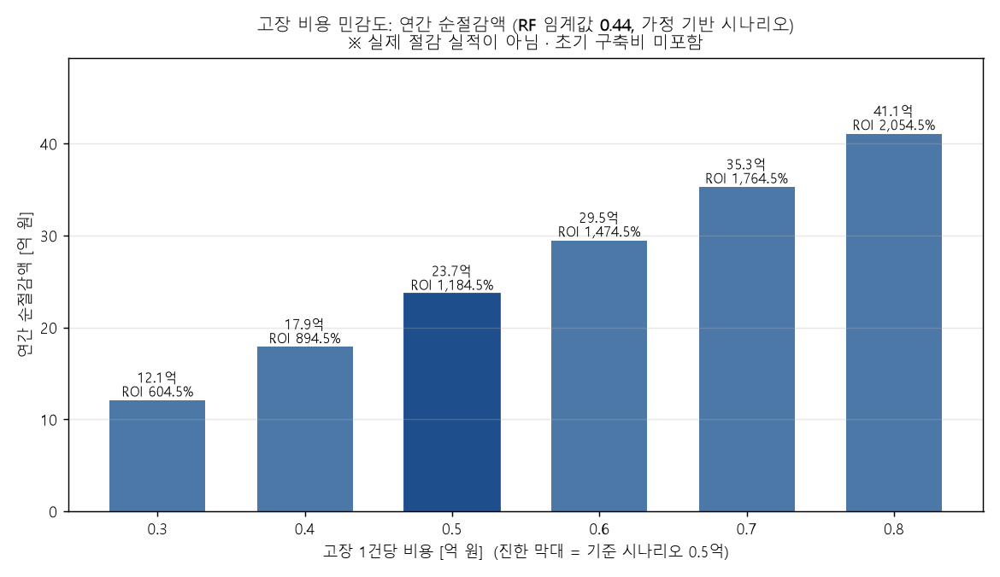

# 도입 비용 시나리오 (경영진 보고)

**질문:** 선택한 RF 임계값의 TP·FP로 도입 비용 시나리오를 계산해줘. (1) 운영비 차감 전 절감액 = TP×(고장비용−정비비) − FP×점검비, (2) 연간 순절감액 = 절감액 − 연간 운영비, (3) ROI = 순절감액 ÷ 운영비 × 100%, (4) 고장 비용 3,000만~8,000만 원 민감도 분석. 측정값과 가정을 구분해 경영진 보고 형태로 정리하고, 실제 절감 실적이 아니며 초기 구축비는 포함하지 않았다고 표시해줘.

**답변:** 가정을 그대로 적용하면 연간 순절감액은 **약 23.7억 원, ROI는 1,184.5%** 입니다. 다만 아래 가정이 모두 맞을 때만 성립하는 **시나리오 계산**입니다.

> ⚠️ **이 문서는 가정에 기반한 시나리오 계산이며, 실제 절감 실적이 아닙니다.** **초기 구축비(개발·설치·교육 등)는 포함하지 않았습니다.** 모델 성능(TP·FP)은 AI4I **합성 데이터**의 Test에서 임계값을 직접 골라 얻은 값이라 낙관적이며, 현장 성능을 보장하지 않습니다.

- 계산 코드: [cost_scenario.py](cost_scenario.py)

## 1. 한눈에 보는 결론 (기준 시나리오: 고장 비용 5,000만 원)

| 항목 | 금액 |
|---|---|
| 운영비 차감 전 절감액 | **25.69억 원** (256,900만 원) |
| 연간 시스템 운영비 | 2.00억 원 |
| **연간 순절감액** | **23.69억 원** (236,900만 원) |
| **ROI** | **1,184.5%** |
| 손익분기 고장 비용 | **약 916만 원/건** (이 값 이상이면 순절감액이 0 이상) |

## 2. 측정값과 가정의 구분

### 측정값 (모델 평가 결과, 폴더 10)

| 항목 | 값 | 비고 |
|---|---|---|
| 모델·임계값 | RandomForest, 0.44 | Recall ≥ 0.85를 만족하는 가장 큰 임계값 |
| TP (탐지한 고장) | **58건** | Test 2,000건 중 |
| FP (오경보) | **41건** | |
| FN (놓친 고장) | 10건 | 재현율 85.3% |
| 정밀도 | 58.6% | |

> 측정값도 Test 라벨을 보며 임계값을 고른 결과여서 독립 평가가 아닙니다.

### 가정 (계산에 넣은 입력, 실측이 아님)

| 항목 | 가정값 |
|---|---|
| 연간 관측 건수 / 고장 건수 | 2,000건 / 68건 (Test 구성과 같다고 가정) |
| 탐지한 고장의 예방 가능 비율 | **100%** (매우 낙관적인 가정) |
| 고장 1건 비용 | 5,000만 원 |
| 예방 정비비 | 500만 원/건 |
| 오경보 점검비 | 100만 원/건 |
| 시스템 연간 운영비 | 2억 원 |

## 3. 계산 과정

| 단계 | 식 | 결과 |
|---|---|---|
| ① 예방으로 줄이는 비용 | 58 × (5,000 − 500) | 261,000만 원 |
| ② 오경보 점검비 | 41 × 100 | 4,100만 원 |
| **운영비 차감 전 절감액** | ① − ② | **256,900만 원 (25.69억)** |
| 연간 운영비 | | 20,000만 원 |
| **연간 순절감액** | 256,900 − 20,000 | **236,900만 원 (23.69억)** |
| **ROI** | 236,900 ÷ 20,000 × 100 | **1,184.5%** |

**도입 전후 총비용 비교 (확인용):**

| | 도입 전 | 도입 후 |
|---|---|---|
| 구성 | 고장 68건 × 5,000만 = 34.0억 | 놓친 10건 × 5,000만 + 정비 58건 × 500만 + 오경보 41건 × 100만 + 운영비 2억 = 10.31억 |
| 합계 | **34.00억** | **10.31억** |
| 차이 | | **23.69억** (순절감액과 일치) |

도입 후에도 **놓친 고장 10건이 5.0억 원의 손실로 남습니다.** 이는 위 절감액 공식에는 드러나지 않는 잔여 리스크입니다.

## 4. 민감도 분석: 고장 비용 3,000만~8,000만 원

| 고장 비용 | 절감액(운영비 차감 전) | 연간 순절감액 | ROI |
|---|---|---|---|
| 3,000만 원 | 14.09억 | 12.09억 | 604.5% |
| 4,000만 원 | 19.89억 | 17.89억 | 894.5% |
| **5,000만 원 (기준)** | 25.69억 | **23.69억** | **1,184.5%** |
| 6,000만 원 | 31.49억 | 29.49억 | 1,474.5% |
| 7,000만 원 | 37.29억 | 35.29억 | 1,764.5% |
| 8,000만 원 | 43.09억 | 41.09억 | 2,054.5% |

- 고장 비용이 1,000만 원 오를 때마다 순절감액이 5.8억 원(= TP 58건 × 1,000만) 늘어납니다.
- 3,000만 원이어도 순절감액과 ROI가 모두 큽니다. 비용 가정보다는 **"탐지한 고장을 정말 100% 예방할 수 있는가"** 가 결과를 좌우합니다.
- 고장 비용이 약 916만 원 이하로 내려가야 손익분기를 밑돕니다.

## 5. 추가 점검: 예방 가능 비율이 100%가 아니라면 (보조 가정)

고장 비용 5,000만 원 기준에서 탐지한 고장 중 실제로 예방에 성공하는 비율만 낮춰 본 것입니다. 정비비는 예방에 성공한 건에만 든다고 단순 가정했습니다.

| 예방 성공 비율 | 연간 순절감액 | ROI |
|---|---|---|
| 100% (요청 가정) | 23.69억 | 1,184.5% |
| 70% | 15.86억 | 793.0% |
| 50% | 10.64억 | 532.0% |
| 30% | 5.42억 | 271.0% |

예방 성공 비율이 30%까지 떨어져도 순절감액은 양수입니다. 다만 이 표는 요청에 없던 보조 점검이며 비율 자체도 가정입니다.

## 6. 해석과 유의사항

- **임계값 선택의 영향:** 기본 임계값 0.5(TP 56, FP 38)로 계산하면 순절감액은 22.82억 원, ROI는 1,141.0%입니다. 임계값 0.44가 순절감액으로 0.87억 원 더 유리합니다. 고장 1건 비용이 오경보 1건 비용보다 훨씬 커서(5,000만 vs 100만 원) 오경보를 감수하고 재현율을 높이는 쪽이 유리하게 계산됩니다.
- **ROI 수치가 매우 큰 이유:** 운영비(2억)에 비해 고장 1건 비용(5,000만 원)이 크고, 연간 고장을 68건으로 가정하며, 탐지한 고장을 전부 예방한다고 가정했기 때문입니다. 현장에서 이렇게 큰 값이 나온다고 기대하면 안 됩니다.
- **과대평가 요인:** (1) 합성 데이터 기반 성능, (2) Test를 보며 임계값을 고른 낙관적 성능, (3) 예방률 100% 가정, (4) 고장률 3.4%가 매년 유지된다는 가정, (5) 초기 구축비·교육비·모델 유지보수비 제외.
- **과소평가 요인:** 다운타임 외의 간접 손실(납기 지연, 품질 불량, 안전사고)은 고장 비용에 포함되지 않았을 수 있습니다.
- **실제 도입 판단을 위해 필요한 것:** 실제 설비 데이터로 별도 검증 데이터에서 임계값을 정하고 보지 않은 Test로 평가, 파일럿 운영으로 실측한 예방률·오경보 대응 비용, 초기 구축비 견적을 반영한 재계산.

## 저장 파일

| 파일 | 내용 |
|---|---|
| `cost_scenario_results.json` | 측정값, 가정, 기준 결과, 도입 전후 비교, 손익분기, 민감도 전체 |
| `sensitivity_failure_cost.csv` | 고장 비용 3,000~8,000만 원별 절감액·순절감액·ROI |
| `sensitivity_failure_cost.png` | 민감도 그래프 |
