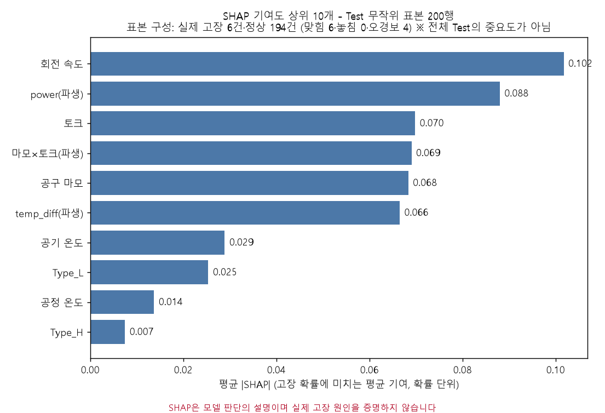
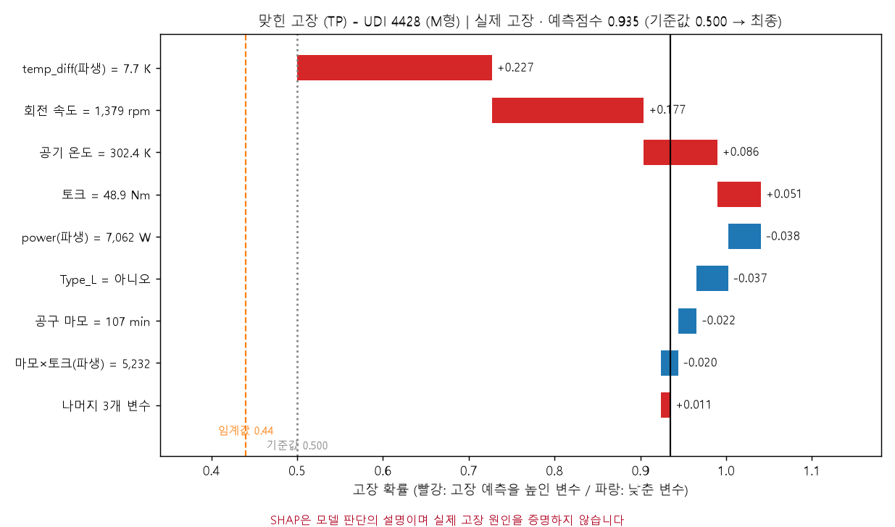
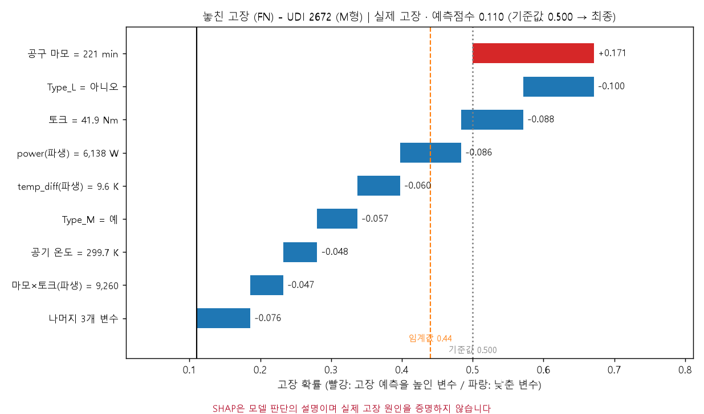
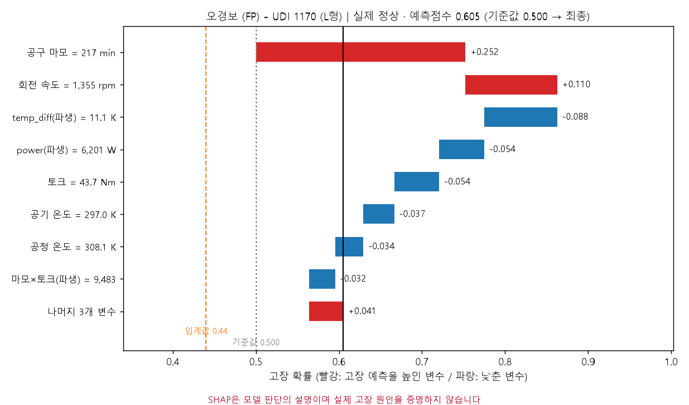

# SHAP으로 보는 랜덤포레스트 예측 설명

**질문:** 앞에서 만든 랜덤포레스트가 왜 고장을 예측했는지 SHAP으로 시각화해줘. (1) Test 200행 표본의 SHAP 기여도 상위 10개 막대그래프, (2) 선택한 임계값 기준으로 맞힌 사례·놓친 사례·오경보 사례 하나씩 선택, (3) 각 사례의 워터폴 그래프, (4) 실제 고장 여부·예측점수·주요 변수값과 짧은 한국어 설명. 기존 모델과 전처리 조건을 그대로 쓰고 예측 일치를 확인하며, 표본 구성을 표시하고 전체 Test의 중요도로 해석하지 말고, SHAP은 실제 원인의 증명이 아님을 표시해줘. 세 사례를 선택하며 볼 수 있는 `prediction_explainer.html`도 만들어줘.

**답변:** 저장된 랜덤포레스트(임계값 0.44)로 세 사례를 골라 변수별 기여를 시각화했습니다. 사례마다 어떤 변수가 고장 예측을 높이고 낮췄는지 확인할 수 있습니다.

> ⚠️ **SHAP은 모델 판단의 설명이며 실제 고장 원인을 증명하지 않습니다.** 변수끼리 상관이 있으면(토크·회전 속도·power) 기여도가 나뉘어 표시됩니다. AI4I 합성 데이터이고 파생변수 3개는 합성 데이터 생성 규칙 기반이라 실제 설비 기준이 아닙니다. 세 사례는 개별 샘플 1건씩이며 일반 규칙이 아닙니다.

- 인터랙티브 화면: [prediction_explainer.html](prediction_explainer.html) (서버 없이 열림, 세 사례를 버튼으로 전환)
- 코드: [shap_explain.py](shap_explain.py)

### 모델·조건 일치 확인
- 폴더 8의 저장된 모델(`rf_model.joblib`)이 있어 그대로 불러 썼습니다. 복원은 필요 없었습니다.
- 모델로 다시 계산한 Test 예측점수가 저장된 `test_predictions.csv`와 일치합니다.
- 전처리된 Test를 역변환하면 원본 Test(`test_original_raw.csv`)와 행 단위로 일치합니다.
- 임계값 0.44는 폴더 10에서 선택한 Recall ≥ 0.85 기준 임계값입니다. 이 임계값에서 Test는 TP 58, FN 10, FP 41, TN 1,891입니다.
- 모든 사례에서 `기준값 + SHAP 합계 = 예측점수`가 성립함을 확인했습니다.

### 1) SHAP 기여도 상위 10개 (Test 무작위 표본 200행)

**표본 구성:** Test 2,000건에서 무작위 200행(random_state=42, 층화하지 않음)

| 구분 | 건수 |
|---|---|
| 실제 고장 | 6 |
| 실제 정상 | 194 |
| 맞힘(TP) / 놓침(FN) | 6 / 0 |
| 오경보(FP) / 정상 판정(TN) | 4 / 190 |

| 순위 | 변수 | 평균 \|SHAP\| |
|---|---|---|
| 1 | 회전 속도 | 0.102 |
| 2 | power (파생) | 0.088 |
| 3 | 토크 | 0.070 |
| 4 | 공구마모×토크 (파생) | 0.069 |
| 5 | 공구 마모 | 0.068 |
| 6 | temp_diff (파생) | 0.066 |
| 7 | 공기 온도 | 0.029 |
| 8 | Type_L | 0.025 |
| 9 | 공정 온도 | 0.014 |
| 10 | Type_H | 0.007 |

> ⚠️ **전체 Test의 중요도로 해석하면 안 됩니다.** 표본에 실제 고장이 6건뿐이고 놓친 고장이 하나도 없어서 정상 샘플의 설명에 치우쳤습니다. 폴더 8의 Feature Importance(모델 전체 기준)와 순서가 다를 수 있습니다. 값은 고장 확률 단위입니다.

### 2) 선택한 세 사례
사례는 전체 Test에서 **유형별(TP·FN·FP) 예측점수의 중앙값에 가장 가까운 샘플**로 골랐습니다. 눈에 띄는 사례를 고르지 않으려고 정한 규칙입니다. 사례는 위 200행 표본과 별개입니다.

| | 맞힌 고장 (TP) | 놓친 고장 (FN) | 오경보 (FP) |
|---|---|---|---|
| UDI / 유형 | 4428 / M | 2672 / M | 1170 / L |
| 실제 | **고장** (HDF 라벨) | **고장** (TWF 라벨) | 정상 |
| 예측점수 (임계값 0.44) | **0.935** → 고장 예측 | **0.110** → 정상 예측 | **0.605** → 고장 예측 |
| 회전 속도 | 1,379 rpm | 1,399 rpm | 1,355 rpm |
| 토크 | 48.9 Nm | 41.9 Nm | 43.7 Nm |
| 공구 마모 | 107 min | 221 min | 217 min |
| temp_diff | 7.7 K | 9.6 K | 11.1 K |
| power | 7,062 W | 6,138 W | 6,201 W |
| 공기 온도 | 302.4 K | 299.7 K | 297.0 K |

### 3) 워터폴 그래프
빨강은 고장 예측을 높인 변수, 파랑은 낮춘 변수입니다. 기준값 0.500은 균형 Train의 평균 예측 확률이며, Test의 실제 고장률(3.4%)이 아닙니다.

| 맞힌 고장 (TP) | 놓친 고장 (FN) | 오경보 (FP) |
|---|---|---|
|  |  |  |

### 4) 사례별 해석

**맞힌 고장 (UDI 4428, 점수 0.935)**
- 높인 변수: temp_diff = 7.7 K (+0.227), 회전 속도 1,379 rpm (+0.177), 공기 온도 302.4 K (+0.086), 토크 (+0.051)
- 낮춘 변수: power (−0.038), Type_L (−0.037)
- 설명: 온도차가 작고 회전 속도가 낮은 조합이 고장 점수를 크게 밀어 올렸습니다. 이 샘플의 실제 라벨은 HDF(방열 불량)이고, 폴더 4에서 확인한 생성 규칙(온도차 8.6 K 미만 + 1,380 rpm 미만)과도 맞아떨어집니다.

**놓친 고장 (UDI 2672, 점수 0.110)**
- 높인 변수: 공구 마모 221 min (+0.171)
- 낮춘 변수: Type_L=아니오 (−0.100), 토크 41.9 Nm (−0.088), power (−0.086), temp_diff (−0.060), Type_M=예 (−0.057)
- 설명: 공구 마모가 높아 고장 쪽으로 밀렸지만, 토크·power·온도차가 평범한 값이라 정상 쪽 힘이 더 컸습니다. 실제 라벨은 TWF(공구 마모)로, 폴더 8에서 확인한 대로 TWF는 현재 변수만으로 잡기 어려운 유형입니다.

**오경보 (UDI 1170, 점수 0.605)**
- 높인 변수: 공구 마모 217 min (+0.252), 회전 속도 1,355 rpm (+0.110)
- 낮춘 변수: temp_diff = 11.1 K (−0.088), power (−0.054), 토크 (−0.054), 공기 온도 (−0.037)
- 설명: 공구 마모가 높고 회전 속도가 낮아 고장 점수가 올랐습니다. 이 샘플은 실제로는 정상이었습니다. 놓친 사례(UDI 2672)와 공구 마모가 비슷한데(221 vs 217 min) 한쪽은 고장, 한쪽은 정상이었고 모델은 둘을 다르게 판단했습니다. 공구 마모 하나만으로는 고장을 가려내기 어렵다는 뜻입니다.

### 주의할 점
- **Type 변수의 기여가 보입니다.** 놓친 사례에서 Type_L=아니오(−0.100), Type_M=예(−0.057)가 고장 점수를 낮췄습니다. 폴더 7에서 확인한 SMOTENC의 Type 편향(합성 고장이 대부분 L형)이 모델에 일부 남은 흔적일 수 있습니다. 제품 유형이 실제로 고장을 일으킨다는 뜻이 아닙니다.
- **파생변수는 중복 정보입니다.** power는 토크 × 회전 속도, 마모×토크는 공구 마모 × 토크라서 원래 변수와 기여가 나뉘어 표시됩니다. 예를 들어 "토크가 작다"는 정보가 토크와 power 양쪽의 음의 기여로 나타납니다.
- 사례 3건으로 모델 전체의 작동 방식을 일반화할 수 없습니다.

### 저장 파일

| 파일 | 내용 |
|---|---|
| `prediction_explainer.html` | 세 사례 선택형 설명 화면 (워터폴·사례 정보·한국어 설명·표본 상위 10개) |
| `shap_top10_sample200.png`, `waterfall_TP/FN/FP.png` | 한글 그림 |
| `shap_cases.json` | 세 사례의 변수값·SHAP 값·예측점수와 표본 요약 |
| `shap_values_sample200.csv`, `shap_sample200_rows.csv` | 표본 200행의 SHAP 값과 행 정보 |
