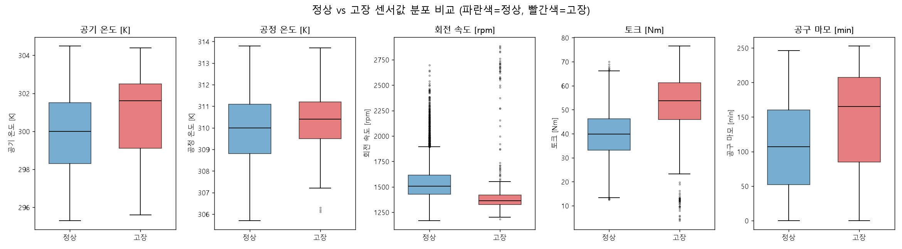
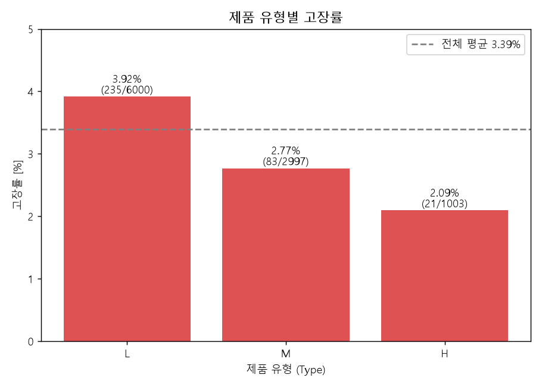

# 정상 vs 고장 센서값 분포 비교

**질문:** 정상(Machine failure=0)과 고장(Machine failure=1)의 센서값 분포를 비교해줘. (1) 5개 센서 변수의 정상/고장 박스플롯을 나란히 그리고(한글 제목·레이블, 정상=파란색, 고장=빨간색), (2) 정상/고장 간 가장 차이가 큰 변수를 해석하고, (3) 제품 유형(L/M/H)별 고장률도 비교해줘.

**답변:** 토크와 회전 속도가 정상과 고장을 가장 잘 구분하는 변수입니다.

### 1) 박스플롯

### 2) 변수별 차이

| 변수 | 정상 평균 | 고장 평균 | 정상 중앙값 | 고장 중앙값 | Cohen's d | KS 통계량 |
|---|---|---|---|---|---|---|
| 토크 [Nm] | 39.63 | 50.17 | 39.9 | 53.7 | **+1.08** | 0.500 |
| 공구 마모 [min] | 106.69 | 143.78 | 107 | 165 | +0.59 | 0.312 |
| 공기 온도 [K] | 299.97 | 300.89 | 300.0 | 301.6 | +0.46 | 0.272 |
| 회전 속도 [rpm] | 1540.26 | 1496.49 | 1507 | 1365 | −0.24 | **0.537** |
| 공정 온도 [K] | 310.00 | 310.29 | 310.0 | 310.4 | +0.20 | 0.176 |

- **토크:** 평균 차이 기준(Cohen's d)으로 가장 큰 변수입니다. 고장 시 토크가 약 10.5 Nm 높고(중앙값 39.9 → 53.7), 고장 데이터는 40 Nm 이하에서 이상치도 보입니다.
- **회전 속도:** 평균 차이는 작지만(d = −0.24) 분포 전체의 차이(KS)는 가장 큽니다. 고장 시 중앙값이 1507 → 1365 rpm으로 낮고 분포 폭이 매우 좁습니다. 고장 데이터에 2,000 rpm 이상 고회전 이상치도 많아서 평균 차이가 작게 나옵니다.
- **토크와 회전 속도의 관계:** 두 변수의 곱이 기계적 출력(전력)이 되므로, 저속·고토크 상태가 과부하(OSF)와 전력 이상(PWF)으로 이어지는 것으로 보입니다.
- **공구 마모:** 마모가 클수록 고장이 많지만, 분포 중첩이 큽니다. 마모 시간이 길어서 생기는 TWF가 일부만 설명합니다.
- **공기 온도, 공정 온도:** 차이가 작습니다. 두 온도의 차이(방열 여유)가 방열 불량(HDF)과 관련 있을 수 있으므로 파생변수(공정 온도 − 공기 온도)로 확인해 볼 만합니다.

### 3) 제품 유형별 고장률

| Type | 건수 | 고장 | 고장률 |
|---|---|---|---|
| L | 6,000 | 235 | 3.92% |
| M | 2,997 | 83 | 2.77% |
| H | 1,003 | 21 | 2.09% |

- L → M → H 순으로 고장률이 낮아집니다. L은 H의 약 1.9배입니다.
- 카이제곱 검정 p = 0.001로 유형별 차이는 통계적으로 유의합니다.
- 다만 이 데이터는 단변량 비교입니다. 변수 간 상호작용(토크×회전 속도, 온도 차이 등)은 이후 분석에서 확인해야 합니다.
