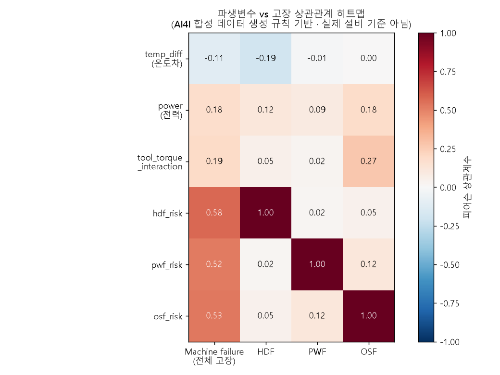
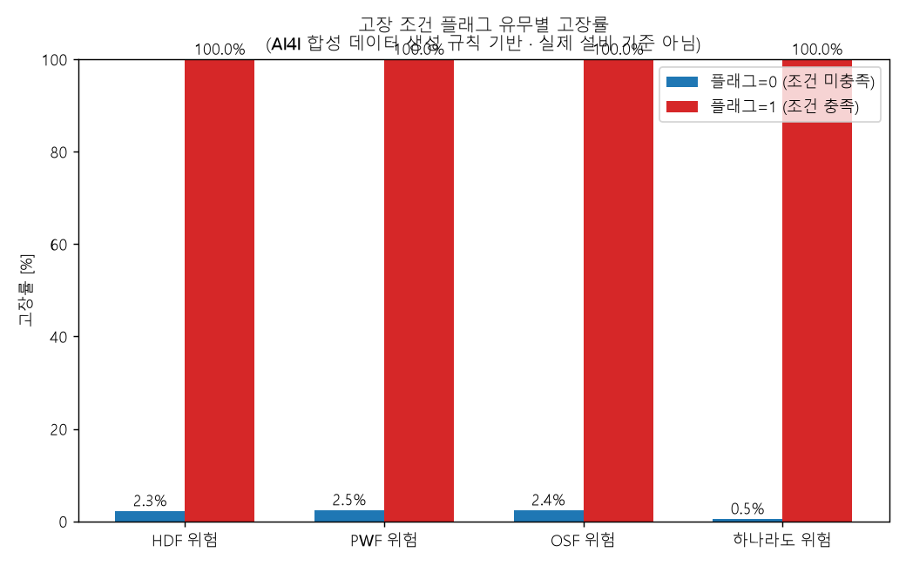
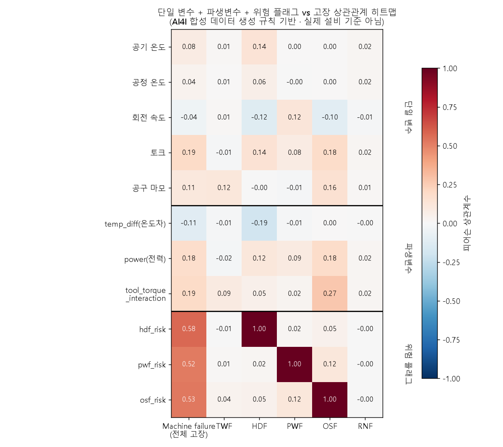
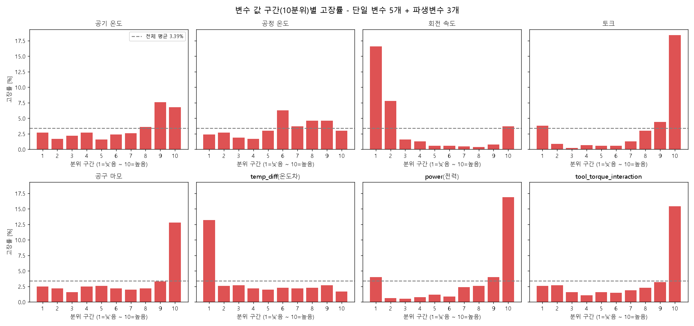

# 고장 메커니즘 기반 파생변수 생성

**질문:** 고장 메커니즘(HDF, PWF, OSF)에 기반해 파생변수(temp_diff, power, tool_torque_interaction, hdf_risk, pwf_risk, osf_risk)를 만들고, 파생변수와 Machine failure의 상관관계 히트맵과 플래그 유무별 고장률 차이를 분석해줘. 이 조건은 AI4I 합성 데이터의 생성 규칙이며 실제 설비 기준이 아니라는 점도 표시해줘.

> ⚠️ **주의:** 아래 조건(8.6K, 1380rpm, 3500~9000W, 유형별 임계값 등)은 **AI4I 2020 합성 데이터의 생성 규칙**입니다. **실제 설비의 고장 기준이 아닙니다.** 실제 현장 데이터에는 이 임계값을 그대로 적용할 수 없습니다.

**답변:** 파생변수 3개와 플래그 3개를 만들었습니다. 플래그 3개는 해당 고장 라벨(HDF, PWF, OSF)과 완전히 일치합니다.

- 결과 데이터: `ai4i2020_features.csv` (원본 14열 + 파생 7열, `any_risk` 포함)

### 1) 파생변수 정의

| 변수 | 정의 |
|---|---|
| temp_diff | Process temperature − Air temperature |
| power | Torque × Rotational speed × 2π/60 [W] |
| tool_torque_interaction | Tool wear × Torque |
| hdf_risk | temp_diff < 8.6 **AND** RPM < 1380 |
| pwf_risk | power < 3500 **OR** power > 9000 |
| osf_risk | tool_torque_interaction > 임계값 (L: 11000 / M: 12000 / H: 13000) |
| any_risk | 위 3개 플래그 중 하나라도 1 (추가 변수) |

### 2) 상관관계 히트맵

| 파생변수 | Machine failure | HDF | PWF | OSF |
|---|---|---|---|---|
| temp_diff | −0.11 | −0.19 | −0.01 | 0.00 |
| power | 0.18 | 0.12 | 0.09 | 0.18 |
| tool_torque_interaction | 0.19 | 0.05 | 0.02 | 0.27 |
| hdf_risk | **0.58** | 1.00 | 0.02 | 0.05 |
| pwf_risk | **0.52** | 0.02 | 1.00 | 0.12 |
| osf_risk | **0.53** | 0.05 | 0.12 | 1.00 |

- 연속형 파생변수(temp_diff, power, tool_torque_interaction)는 Machine failure와 상관이 낮습니다(|r| ≤ 0.19). 고장이 선형 관계가 아니라 임계값 조건이기 때문입니다.
- 이진 플래그는 상관이 0.5 이상으로 훨씬 높습니다.
- 각 플래그는 자기 고장 유형과 상관이 1.00이고 다른 유형과는 거의 0입니다. 세 고장 메커니즘이 서로 독립적입니다.

### 3) 플래그 유무별 고장률

| 플래그 | 값 | 건수 | 고장 | 고장률 |
|---|---|---|---|---|
| hdf_risk | 0 | 9,885 | 224 | 2.27% |
| hdf_risk | 1 | 115 | 115 | **100%** |
| pwf_risk | 0 | 9,905 | 244 | 2.46% |
| pwf_risk | 1 | 95 | 95 | **100%** |
| osf_risk | 0 | 9,902 | 241 | 2.43% |
| osf_risk | 1 | 98 | 98 | **100%** |
| any_risk | 0 | 9,713 | 52 | 0.54% |
| any_risk | 1 | 287 | 287 | **100%** |

- 플래그가 1이면 예외 없이 고장입니다. 플래그가 0이면 고장률이 약 0.5~2.5%로 크게 낮아집니다.
- 플래그와 해당 고장 라벨 사이의 정밀도와 재현율은 모두 1.0입니다 (HDF 115건, PWF 95건, OSF 98건 일치).
- 위험 조건이 2개 겹친 행은 21건이며, 모두 고장입니다.
- `any_risk`는 전체 고장 339건 중 287건(재현율 84.7%)을 잡습니다.
- 잡지 못한 52건은 TWF(공구 마모) 43건, RNF 1건, 유형 라벨이 없는 9건입니다. TWF 조건은 이번에 만들지 않았고, RNF는 랜덤 노이즈라 규칙으로 잡을 수 없습니다.

### 4) 해석과 주의점
- 이 결과는 **합성 데이터의 라벨이 이 규칙으로 만들어졌기 때문에** 나온 것입니다. 모델 성능으로 해석하면 안 됩니다.
- 이 플래그를 모델 입력으로 쓰면 정답이 새어 들어가는 **데이터 누수(leakage)** 효과가 있습니다. 모델 성능이 비현실적으로 높게 나옵니다.
- 실제 설비에서는 임계값을 도메인 전문가와 이력 데이터로 직접 찾아야 합니다.

---

## 추가 분석: 단일 변수 + 파생변수 전체 그래프

**요청:** 파생변수만이 아니라 원래의 단일 변수(센서 5개)까지 모두 포함해서 그래프를 다시 그려줘.

**답변:** 센서 5개, 파생변수 3개, 위험 플래그 3개를 한 번에 비교하는 그래프 2개를 새로 만들었습니다. 위의 기존 그래프는 그대로 두었습니다.

### 1) 전체 상관관계 히트맵

열은 전체 고장과 고장 유형 5개(TWF, HDF, PWF, OSF, RNF)입니다.

| 구분 | 변수 | Machine failure와의 상관 |
|---|---|---|
| 단일 변수 | 토크 | 0.19 |
| 단일 변수 | 공구 마모 | 0.11 |
| 단일 변수 | 공기 온도 | 0.08 |
| 단일 변수 | 회전 속도 | −0.04 |
| 단일 변수 | 공정 온도 | 0.04 |
| 파생변수 | tool_torque_interaction | 0.19 |
| 파생변수 | power | 0.18 |
| 파생변수 | temp_diff | −0.11 |
| 위험 플래그 | hdf_risk / osf_risk / pwf_risk | 0.58 / 0.53 / 0.52 |

- 단일 변수와 연속형 파생변수는 모두 상관이 0.2 이하로 낮습니다. 선형 상관만으로는 고장과의 관계를 거의 설명하지 못합니다.
- 가장 높은 단일 변수는 토크(0.19)이고, 파생변수 중에서는 tool_torque_interaction(0.19)과 power(0.18)가 비슷한 수준입니다.
- 회전 속도는 전체 고장과의 상관이 −0.04로 거의 없지만, 고장 유형별로는 HDF −0.12, PWF +0.12, OSF −0.10으로 부호가 갈립니다. 유형마다 방향이 달라서 전체로 합치면 서로 상쇄됩니다.
- 위험 플래그만 0.5 이상이며, 각 플래그는 자기 고장 유형과 상관이 1.00입니다.

### 2) 10분위 구간별 고장률

각 변수의 값을 낮은 쪽부터 10개 구간으로 나눈 뒤 구간별 고장률을 비교했습니다. 점선은 전체 평균(3.39%)입니다.

| 변수 | 고장률이 높은 구간 | 최고 고장률 |
|---|---|---|
| 토크 | 가장 높은 10분위 | 18.4% |
| power | 가장 높은 10분위 (가장 낮은 구간도 4.0%) | 16.9% |
| tool_torque_interaction | 가장 높은 10분위 | 15.4% |
| 공구 마모 | 가장 높은 10분위 | 12.8% |
| 회전 속도 | 가장 낮은 10분위 | 16.6% |
| temp_diff | 가장 낮은 10분위 | 13.2% |
| 공기 온도 | 높은 쪽 9~10분위 | 7.6% |
| 공정 온도 | 중간 이상 6분위 | 6.3% |

- 상관계수가 낮아도 **양 끝 구간에서 고장률이 크게 오릅니다.** 토크 상위 10%는 고장률이 18.4%로 전체 평균의 5배가 넘습니다.
- 비선형 관계가 뚜렷합니다. power는 양쪽 끝에서 모두 높고(U자형), 회전 속도는 낮은 쪽에서만 높습니다. 상관계수가 이런 관계를 놓치므로 두 그래프를 함께 봐야 합니다.
- 공기 온도와 공정 온도는 구간별 차이가 작고, temp_diff는 가장 낮은 구간(온도차가 작을 때)에서만 두드러집니다.
- 이 임계값 기반 관계는 합성 데이터 생성 규칙의 영향이 크며 실제 설비 기준이 아닙니다.
