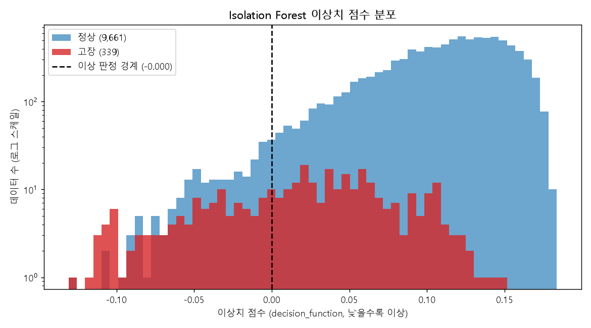
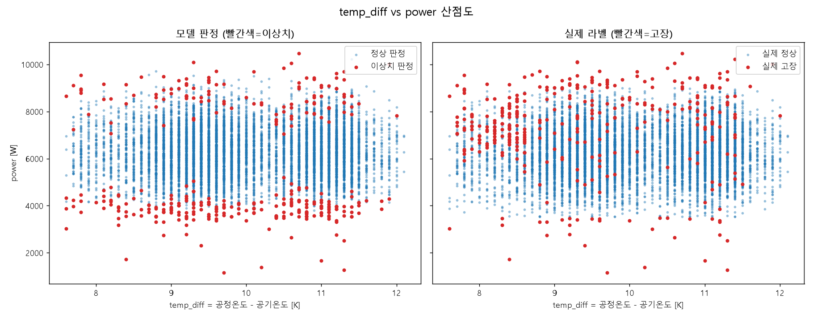

# Isolation Forest 비지도 이상 탐지

**질문:** Isolation Forest(contamination=0.034, random_state=42)로 비지도 이상 탐지를 수행해줘. 피처는 5개 센서 변수와 파생변수 3개(temp_diff, power, tool_torque_interaction)를 쓰고, (1) 이상치 중 실제 고장 비율, (2) 정상 판정 중 실제 고장 비율, (3) 이상치 점수 히스토그램, (4) temp_diff vs power 산점도(이상치=빨간 점)를 만들고 라벨 없이 고장을 얼마나 잡는지 해석해줘.

**답변:** 라벨 없이도 고장을 무작위보다 약 10배 잘 골라내지만, 고장의 3분의 1만 잡습니다.

- 결과 파일: 이 폴더 (그래프 2개, `iforest_results.csv`)

### 1) 2) 판정 결과 vs 실제 고장

| 모델 판정 | 건수 | 실제 고장 | 고장 비율 |
|---|---|---|---|
| 이상치 | 340 | 113 | **33.2%** |
| 정상 | 9,660 | 226 | **2.34%** |
| 전체 평균 | 10,000 | 339 | 3.39% |

| 지표 | 값 |
|---|---|
| 정밀도 (Precision) | 0.332 |
| 재현율 (Recall) | 0.333 (339건 중 113건) |
| Lift | 9.8배 (무작위 3.39% 대비) |
| ROC-AUC (점수 기준) | 0.887 |
| PR-AUC | 0.293 (무작위 기준선 0.034) |

### 3) 이상치 점수 분포

- 정상의 평균 점수는 0.109, 고장은 0.021입니다. 고장이 낮은(이상한) 쪽으로 치우쳐 있습니다.
- 두 분포는 상당히 겹칩니다(고장 점수 표준편차 0.059). 점수만으로 깨끗하게 분리되지는 않습니다.

### 4) temp_diff vs power 산점도

- 이상치(빨간 점)는 power가 매우 높거나 낮은 위·아래 가장자리에 몰려 있습니다. 모델이 power 극단값을 주로 이상으로 봅니다.
- temp_diff는 영향이 작습니다. 이상치가 temp_diff 전 구간에 퍼져 있습니다.

### 고장 유형별 탐지율

| 유형 | 탐지 / 전체 | 탐지율 |
|---|---|---|
| PWF (전력 이상) | 67 / 95 | 70.5% |
| OSF (과부하) | 51 / 98 | 52.0% |
| HDF (방열 불량) | 14 / 115 | 12.2% |
| TWF (공구 마모) | 5 / 46 | 10.9% |
| RNF (랜덤) | 0 / 19 | 0% |

### 해석
- **잘 잡는 고장:** power의 극단값으로 나타나는 PWF와 OSF는 절반 이상 잡습니다. 데이터에서 "드문 값"으로 눈에 띄기 때문입니다.
- **놓치는 고장:** HDF는 "온도차가 작고 회전 속도가 낮다"는 두 변수의 조합 조건입니다. 각 변수 값 자체는 평범해서 이상치로 보이지 않습니다. TWF도 공구 마모 값이 정상 범위 안에서 발생합니다. RNF는 랜덤 노이즈라 원리상 잡을 수 없습니다.
- **한계:** 이상치로 판정한 340건 중 227건은 실제로는 정상입니다(오탐). 정상 데이터 중에도 극단값이 많기 때문입니다.
- **활용:** 라벨이 없는 초기 단계의 후보 선별 용도로는 쓸 수 있습니다. 고장 유형별 조건을 학습하는 지도학습 모델(Random Forest 등)보다 성능이 낮을 것이므로, 라벨이 확보되면 지도학습으로 넘어가는 것이 좋습니다.
- **참고:** 파생변수 중 power는 Q4에서 만든 합성 데이터 생성 규칙 기반 변수입니다. 이 결과는 실제 설비 성능이 아닙니다.
