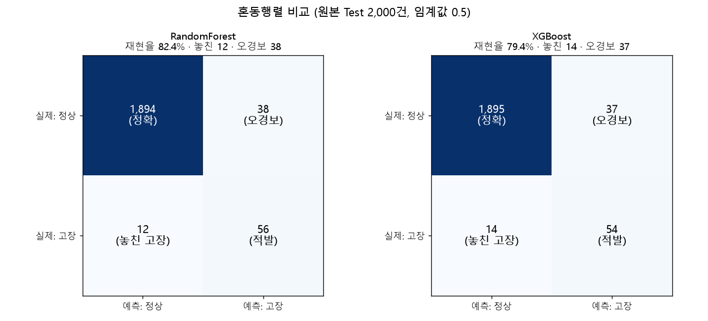
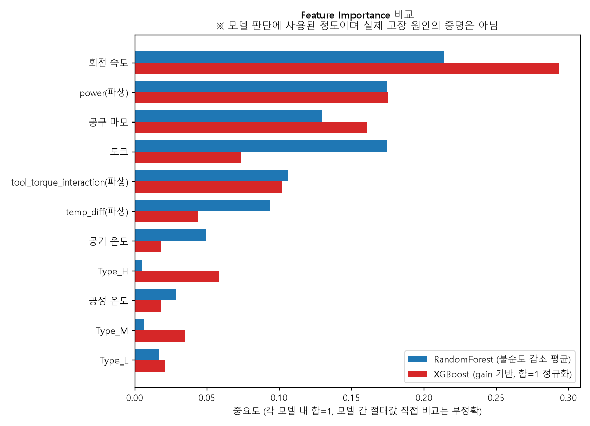

# XGBoost 학습과 랜덤포레스트 비교

**질문:** 랜덤포레스트와 동일한 SMOTENC 보강 Train으로 XGBoost(scale_pos_weight=1, n_estimators=200, max_depth=6, learning_rate=0.1, eval_metric='aucpr', random_state=42)를 학습하고, 같은 원본 Test·기본 임계값 0.5에서 두 모델을 비교해줘. (1) 성능 비교표(Accuracy, Precision, Recall, F1, AUC), (2) 혼동행렬 나란히, (3) Feature Importance 비교(산출 방식 차이 표시), (4) 재현율 0.85 이상 달성 여부와 오경보 해석, 그리고 모델 선택 근거를 설명하고 모델·예측점수·평가 결과를 저장해줘.

**답변:** 기본 임계값 0.5에서는 **두 모델 모두 재현율 0.85에 못 미칩니다.** 랜덤포레스트가 82.4%, XGBoost가 79.4%입니다. 기본 임계값 기준으로는 **랜덤포레스트를 선택**하되, 차이가 작아서 확정적이지는 않습니다.

- 학습·비교 코드: [train_xgb_compare.py](train_xgb_compare.py)
- 동일 조건: 같은 Train(15,458건, 1:1), 같은 원본 Test(2,000건, 고장 68건), 임계값 0.5. 랜덤포레스트 예측은 폴더 8에 저장한 값과 일치함을 확인했습니다.

> ⚠️ power, tool_torque_interaction, temp_diff는 AI4I 합성 데이터의 생성 규칙에서 나온 변수라 이 성능은 실제 설비 성능이 아닙니다. 분할 1회 결과이고, 양성이 68건뿐이라 1~2건 차이는 우연일 수 있습니다.

### 1) 성능 비교 (임계값 0.5)

| 지표 | 랜덤포레스트 | XGBoost | 우세 |
|---|---|---|---|
| Accuracy | 0.9750 | 0.9745 | 차이 미미 |
| Precision | 0.5957 | 0.5934 | 차이 미미 |
| **Recall** | **0.8235** | 0.7941 | RF |
| F1-Score | 0.6914 | 0.6792 | RF |
| ROC-AUC | 0.9742 | **0.9767** | XGB |
| PR-AUC | 0.8281 | **0.8551** | XGB |
| 놓친 고장 (FN) | **12** | 14 | RF |
| 오경보 (FP) | 38 | **37** | 차이 미미 |

### 2) 혼동행렬 비교

| | RF 예측: 정상 | RF 예측: 고장 | XGB 예측: 정상 | XGB 예측: 고장 |
|---|---|---|---|---|
| 실제: 정상 | 1,894 | 38 (오경보) | 1,895 | 37 (오경보) |
| 실제: 고장 | 12 (놓침) | 56 (적발) | 14 (놓침) | 54 (적발) |

ROC 곡선 비교: [roc_compare.png](roc_compare.png)

### 3) Feature Importance 비교

> ⚠️ **산출 방식이 다릅니다.** 랜덤포레스트는 노드 분할 때의 불순도 감소 평균, XGBoost는 분할의 gain(손실 감소량) 기반 값을 합이 1이 되게 정규화한 것입니다. 두 모델의 절대값은 직접 비교할 수 없고 순위와 경향만 참고해야 합니다. 또한 **변수 중요도는 모델 판단에 사용된 정도이며 실제 고장 원인의 증명이 아닙니다.**

| 변수 | RF | XGBoost |
|---|---|---|
| rpm (회전 속도) | 0.214 | 0.293 |
| power (파생) | 0.175 | 0.175 |
| tool_wear (공구 마모) | 0.130 | 0.161 |
| tool_torque_interaction (파생) | 0.106 | 0.102 |
| torque (토크) | 0.174 | 0.074 |
| Type_H | 0.005 | **0.059** |
| temp_diff (파생) | 0.094 | 0.044 |
| Type_M | 0.007 | 0.035 |
| Type_L | 0.017 | 0.021 |
| process_temp | 0.029 | 0.019 |
| air_temp | 0.050 | 0.018 |

- 두 모델 모두 회전 속도, power, 공구 마모를 상위에 둡니다. 큰 흐름은 같습니다.
- 토크는 RF에서는 3위(0.174)인데 XGBoost에서는 0.074로 낮습니다. power(토크×회전 속도)와 정보가 겹쳐서 XGBoost는 power에 판단을 몰아준 것으로 보입니다.
- **Type 3개의 합이 XGBoost에서 0.115로 RF(0.029)보다 훨씬 큽니다.** 특히 Type_H가 6위(0.059)입니다. 폴더 7에서 SMOTENC가 합성 고장 샘플을 거의 L로 만들어(H는 0.2%) Type_H가 "정상" 신호로 학습되었을 가능성이 있습니다. XGBoost가 이 인위적인 패턴을 더 많이 따라간 것으로 의심됩니다.

### 4) 재현율 0.85 달성 여부와 오경보

**임계값 0.5 (요청 조건):** 달성하지 못했습니다.

| 모델 | 재현율 | 부족한 건수 | 오경보 |
|---|---|---|---|
| 랜덤포레스트 | 82.4% | 0.85 목표(58건)까지 2건 부족 | 38건 |
| XGBoost | 79.4% | 0.85 목표(58건)까지 4건 부족 | 37건 |

**참고: 임계값을 낮췄을 때 (Test 기준)**

| 모델 | 임계값 | 재현율 | 정밀도 | 놓친 고장 | 오경보 |
|---|---|---|---|---|---|
| 랜덤포레스트 | 0.50 | 82.4% | 59.6% | 12 | 38 |
| 랜덤포레스트 | **0.44** | **85.3%** | 58.6% | 10 | **41** |
| 랜덤포레스트 | 0.30 | 88.2% | 44.8% | 8 | 74 |
| XGBoost | 0.50 | 79.4% | 59.3% | 14 | 37 |
| XGBoost | **0.314** | **85.3%** | 53.7% | 10 | **50** |
| XGBoost | 0.20 | 86.8% | 49.2% | 9 | 61 |

- 재현율 0.85에 도달하는 가장 높은 임계값에서 랜덤포레스트는 오경보 41건, XGBoost는 50건입니다. **같은 재현율(85.3%)이면 랜덤포레스트가 오경보를 9건 덜 냅니다.**
- XGBoost는 임계값을 0.2 이하로 낮춰도 재현율이 86.8%에서 더 오르지 않고 오경보만 늘어납니다. 확률이 일부 고장에 낮게 매겨졌다는 뜻입니다.
- ⚠️ 이 임계값 표는 **Test를 보면서 고른 값**이라 성능이 낙관적으로 나옵니다. 실제로 임계값을 정하려면 별도의 검증 데이터나 교차검증으로 정해야 합니다. 여기서는 참고용입니다.

### 모델 선택: 랜덤포레스트 (조건부)

| 근거 | 설명 |
|---|---|
| 재현율 | 기본 임계값 0.5에서 RF 82.4% > XGB 79.4% (고장 2건 더 적발). 놓친 고장이 12 vs 14건으로 더 적음 |
| 오경보 | 거의 같음 (38 vs 37). 재현율을 올려도 RF가 오경보를 덜 늘림 (0.85 기준 41 vs 50) |
| 안정성 | XGBoost가 Type_H 등 SMOTENC의 인위적 패턴에 더 의존하는 것으로 의심됨 |
| 해석 | 랜덤포레스트의 중요도가 토크·power·회전 속도에 고르게 분산되어 설명하기 쉬움 |

**XGBoost에 유리한 점:** ROC-AUC(0.977 vs 0.974)와 PR-AUC(0.855 vs 0.828)가 더 높습니다. 점수의 순위 매기는 능력은 XGBoost가 좋다는 뜻이므로, 임계값을 따로 조정하면 XGBoost도 경쟁력이 있습니다.

**한계:** 두 모델의 재현율 차이는 고장 2건(68건 중)입니다. 통계적으로 구분하기 어렵고, 분할 1회라서 시드나 분할이 바뀌면 순서가 뒤집힐 수 있습니다. 두 모델 모두 공구 마모(TWF) 고장을 놓치는 약점은 같다고 보는 것이 안전합니다(폴더 8 참고). 선택을 확정하려면 교차검증과 별도 검증 데이터에서의 임계값 조정이 필요합니다.

### 저장 파일

| 파일 | 내용 |
|---|---|
| `xgb_model.json`, `xgb_model.joblib` | 학습한 XGBoost 모델 (XGBoost 고유 형식과 joblib 두 가지) |
| `xgb_config.json` | 설정, 임계값, 입력 열 목록 |
| `test_predictions_both.csv` | Test 2,000건의 실제값, RF·XGBoost 고장 확률, 0.5 기준 예측 |
| `compare_metrics.json` | 두 모델의 평가 지표, 임계값별 결과, 변수 중요도 |
| `confusion_matrix_compare.png`, `roc_compare.png`, `feature_importance_compare.png` | 비교 그래프 |
