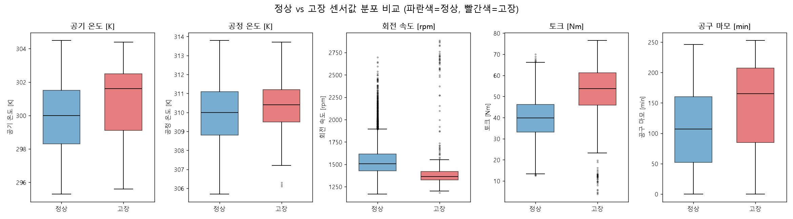
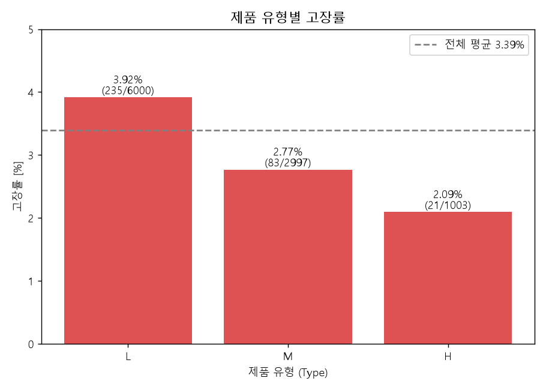

# PdM_Lab 실습 기록 (질문 & 답변)

AI4I 2020 Predictive Maintenance 데이터셋 실습의 질문과 답변을 순서대로 기록합니다.

---

## Q1. 데이터셋 다운로드

**질문:** UCI Machine Learning Repository에서 AI4I 2020 Predictive Maintenance 데이터셋(https://archive.ics.uci.edu/dataset/601)을 다운로드해서 이 폴더에 저장하고, 파일 목록과 데이터 크기를 확인해줘.

**답변:** `D:\PdM_Lab\ai4i_download\`에 다운로드하고 압축을 풀었습니다.

| 파일 | 크기 |
|---|---|
| `ai4i2020.csv` | 522,048 bytes (약 510 KB) |
| `dataset.zip` | 522,170 bytes (약 510 KB) |

- 헤더를 뺀 10,000행, 14개 컬럼입니다.
- 컬럼: UDI, Product ID, Type, 공기 온도, 공정 온도, 회전 속도, 토크, 공구 마모, Machine failure, TWF, HDF, PWF, OSF, RNF
- CSV 맨 앞에 BOM이 있습니다. pandas로 읽을 때는 `encoding='utf-8-sig'`를 사용합니다.

---

## Q2. 기초 탐색적 데이터 분석(EDA)

**질문:** 제조 설비 예지보전(PdM) 분석 전문가로서 CNC 밀링 머신 센서 데이터(`ai4i2020.csv`)에 대해 (1) 데이터 구조, (2) 기초 통계량, (3) 결측값, (4) Machine failure 분포, (5) 고장 유형별 발생 건수를 한국어 표로 정리해줘.

**답변:** 결측값은 없고, 고장은 전체의 3.39%뿐입니다.

### 1) 데이터 구조 (10,000행 × 14열)

| 컬럼 | 타입 | 설명 |
|---|---|---|
| UDI | int64 | 일련번호 |
| Product ID | str | 제품 ID |
| Type | str | 제품 등급 (L 60% / M 30% / H 10%) |
| Air temperature [K] | float64 | 공기 온도 |
| Process temperature [K] | float64 | 공정 온도 |
| Rotational speed [rpm] | int64 | 회전 속도 |
| Torque [Nm] | float64 | 토크 |
| Tool wear [min] | int64 | 공구 마모 시간 |
| Machine failure | int64 | 고장 여부 (0/1) |
| TWF, HDF, PWF, OSF, RNF | int64 | 고장 유형별 라벨 (0/1) |

### 2) 기초 통계량 (센서 변수)

| 변수 | 평균 | 표준편차 | 최솟값 | 최댓값 |
|---|---|---|---|---|
| 공기 온도 [K] | 300.00 | 2.00 | 295.3 | 304.5 |
| 공정 온도 [K] | 310.01 | 1.48 | 305.7 | 313.8 |
| 회전 속도 [rpm] | 1538.78 | 179.28 | 1168 | 2886 |
| 토크 [Nm] | 39.99 | 9.97 | 3.8 | 76.6 |
| 공구 마모 [min] | 107.95 | 63.65 | 0 | 253 |

회전 속도의 최댓값(2886)은 평균에서 약 7.5σ 떨어진 값이라 이상치 후보입니다.

### 3) 결측값

| 항목 | 결과 |
|---|---|
| 전체 결측값 | 0개 |
| 중복 행 | 0개 |

### 4) Machine failure 분포

| 구분 | 건수 | 비율 |
|---|---|---|
| 정상 (0) | 9,661 | 96.61% |
| 고장 (1) | 339 | 3.39% |

- 정상과 고장의 비율이 약 28.5 : 1인 심한 클래스 불균형입니다.
- 모델링할 때는 accuracy 대신 Recall, F1, PR-AUC를 쓰고 가중치나 샘플링으로 보정해야 합니다.

| Type | 건수 | 고장 | 고장률 |
|---|---|---|---|
| L | 6,000 | 235 | 3.92% |
| M | 2,997 | 83 | 2.77% |
| H | 1,003 | 21 | 2.09% |

### 5) 고장 유형별 발생 건수

| 유형 | 의미 | 건수 | 고장 중 비중 |
|---|---|---|---|
| HDF | 방열 불량 | 115 | 33.9% |
| OSF | 과부하 | 98 | 28.9% |
| PWF | 전력 이상 | 95 | 28.0% |
| TWF | 공구 마모 | 46 | 13.6% |
| RNF | 랜덤 고장 | 19 | 5.6% |

- 유형별 건수의 합(373)이 고장 339건보다 많습니다. 2개 이상의 유형이 동시에 표시된 행이 24건 있기 때문입니다.
- Machine failure가 1인데 유형 라벨이 모두 0인 행이 9건 있습니다. 라벨 불일치이므로 전처리 때 확인이 필요합니다.
- RNF(랜덤 고장) 19건은 대부분 Machine failure가 0입니다. 센서값으로 예측할 수 없는 노이즈 성격입니다.

---

## Q3. 정상 vs 고장 센서값 분포 비교

**질문:** 정상(Machine failure=0)과 고장(Machine failure=1)의 센서값 분포를 비교해줘. (1) 5개 센서 변수의 정상/고장 박스플롯을 나란히 그리고(한글 제목·레이블, 정상=파란색, 고장=빨간색), (2) 정상/고장 간 가장 차이가 큰 변수를 해석하고, (3) 제품 유형(L/M/H)별 고장률도 비교해줘.

**답변:** 토크와 회전 속도가 정상과 고장을 가장 잘 구분하는 변수입니다.

### 1) 박스플롯

### 2) 변수별 차이

| 변수 | 정상 평균 | 고장 평균 | 정상 중앙값 | 고장 중앙값 | Cohen's d | KS 통계량 |
|---|---|---|---|---|---|---|
| 토크 [Nm] | 39.63 | 50.17 | 39.9 | 53.7 | **+1.08** | 0.500 |
| 공구 마모 [min] | 106.69 | 143.78 | 107 | 165 | +0.59 | 0.312 |
| 공기 온도 [K] | 299.97 | 300.89 | 300.0 | 301.6 | +0.46 | 0.272 |
| 회전 속도 [rpm] | 1540.26 | 1496.49 | 1507 | 1365 | −0.24 | **0.537** |
| 공정 온도 [K] | 310.00 | 310.29 | 310.0 | 310.4 | +0.20 | 0.176 |

- **토크:** 평균 차이 기준(Cohen's d)으로 가장 큰 변수입니다. 고장 시 토크가 약 10.5 Nm 높고(중앙값 39.9 → 53.7), 고장 데이터는 40 Nm 이하에서 이상치도 보입니다.
- **회전 속도:** 평균 차이는 작지만(d = −0.24) 분포 전체의 차이(KS)는 가장 큽니다. 고장 시 중앙값이 1507 → 1365 rpm으로 낮고 분포 폭이 매우 좁습니다. 고장 데이터에 2,000 rpm 이상 고회전 이상치도 많아서 평균 차이가 작게 나옵니다.
- **토크와 회전 속도의 관계:** 두 변수의 곱이 기계적 출력(전력)이 되므로, 저속·고토크 상태가 과부하(OSF)와 전력 이상(PWF)으로 이어지는 것으로 보입니다.
- **공구 마모:** 마모가 클수록 고장이 많지만, 분포 중첩이 큽니다. 마모 시간이 길어서 생기는 TWF가 일부만 설명합니다.
- **공기 온도, 공정 온도:** 차이가 작습니다. 두 온도의 차이(방열 여유)가 방열 불량(HDF)과 관련 있을 수 있으므로 파생변수(공정 온도 − 공기 온도)로 확인해 볼 만합니다.

### 3) 제품 유형별 고장률

| Type | 건수 | 고장 | 고장률 |
|---|---|---|---|
| L | 6,000 | 235 | 3.92% |
| M | 2,997 | 83 | 2.77% |
| H | 1,003 | 21 | 2.09% |

- L → M → H 순으로 고장률이 낮아집니다. L은 H의 약 1.9배입니다.
- 카이제곱 검정 p = 0.001로 유형별 차이는 통계적으로 유의합니다.
- 다만 이 데이터는 단변량 비교입니다. 변수 간 상호작용(토크×회전 속도, 온도 차이 등)은 이후 분석에서 확인해야 합니다.
