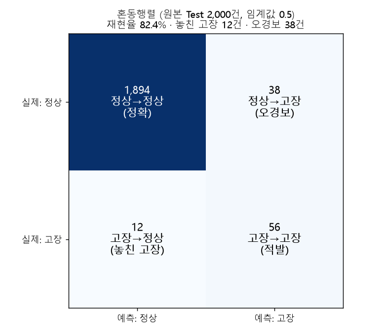
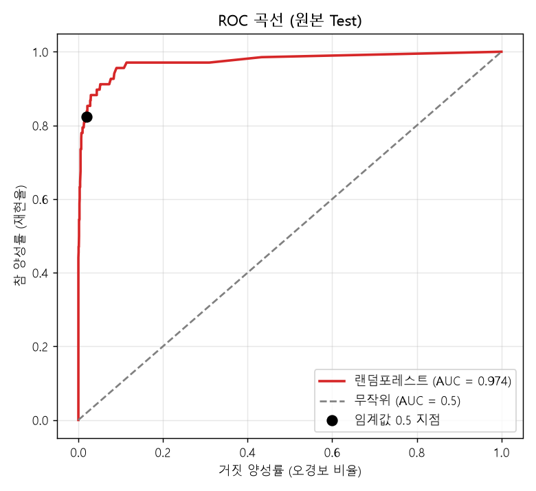
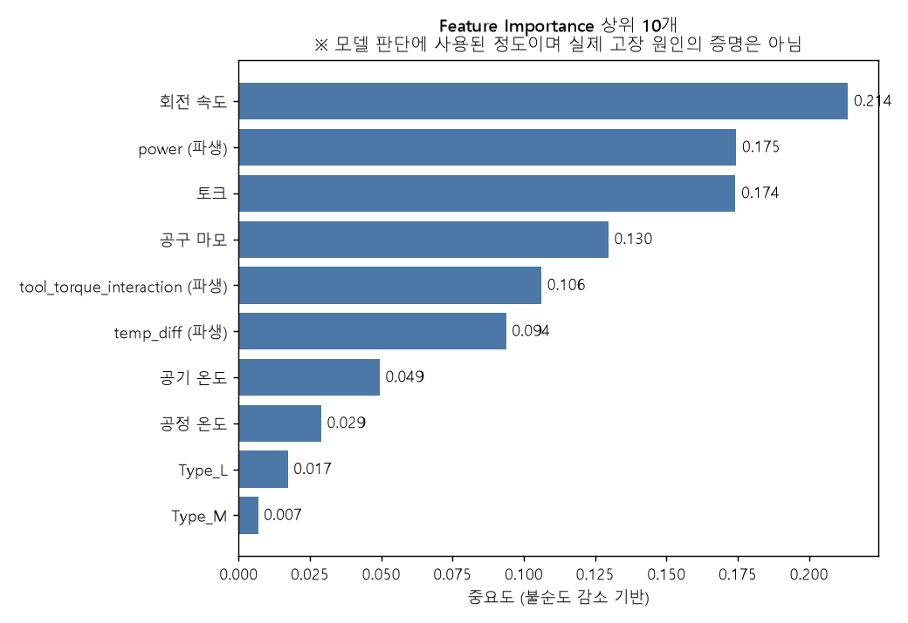

# 랜덤포레스트 학습과 원본 Test 평가

**질문:** SMOTENC로 1:1 보강한 Train으로 랜덤포레스트(n_estimators=200, random_state=42, class_weight='balanced')를 학습해 Machine failure를 예측하고, 원본 Test에서 기본 임계값 0.5로 평가해줘. (1) 혼동행렬 히트맵, (2) 분류 보고서, (3) ROC 곡선과 AUC, (4) Feature Importance 상위 10개를 보여주고, Recall을 강조하며 놓친 고장과 오경보 건수를 함께 표시해줘. 모델·설정·Test 예측점수·평가 결과를 저장하고, 변수 중요도는 실제 고장 원인의 증명이 아니라고 표시해줘.

**답변:** 원본 Test에서 **재현율(Recall) 82.4%**입니다. 고장 68건 중 56건을 잡았고, **12건을 놓쳤으며**, 정상 38건을 고장으로 **오경보**했습니다.

- 학습 코드: [train_rf.py](train_rf.py)
- 학습 데이터: Step 2의 1번 폴더의 SMOTENC 보강 Train (15,458건, 정상 7,729 : 고장 7,729). 이 균형 데이터에서는 `class_weight='balanced'` 가중치가 두 클래스 모두 1이라 실질적인 효과가 없습니다.
- 평가 데이터: 합성 없이 보존한 원본 Test (2,000건, 고장 68건 = 3.40%)

> ⚠️ 입력 변수 중 power, tool_torque_interaction, temp_diff는 AI4I 합성 데이터의 생성 규칙에서 나온 변수입니다. 이 성능은 실제 설비 성능이 아닙니다. 분할 1회, 임계값 0.5 기준의 결과이며 교차검증은 하지 않았습니다.

### 핵심 결과

| 지표 | 값 |
|---|---|
| **재현율 (Recall)** | **82.4%** (56 / 68) |
| 정밀도 (Precision) | 59.6% (56 / 94) |
| F1-Score (고장) | 0.691 |
| 정확도 (Accuracy) | 97.5% |
| ROC-AUC | 0.974 |
| PR-AUC | 0.828 (무작위 기준선 0.034) |
| **놓친 고장 (FN)** | **12건** |
| **오경보 (FP)** | **38건** |

### 1) 혼동행렬

| | 예측: 정상 | 예측: 고장 |
|---|---|---|
| 실제: 정상 | 1,894 (정확) | 38 (오경보) |
| 실제: 고장 | 12 (놓친 고장) | 56 (적발) |

### 2) 분류 보고서

| 클래스 | Precision | Recall | F1-Score | 건수 |
|---|---|---|---|---|
| 정상 | 0.9937 | 0.9803 | 0.9870 | 1,932 |
| **고장** | **0.5957** | **0.8235** | **0.6914** | 68 |
| macro avg | 0.7947 | 0.9019 | 0.8392 | 2,000 |
| weighted avg | 0.9802 | 0.9750 | 0.9769 | 2,000 |

### 3) ROC 곡선

AUC 0.974입니다. 검은 점은 임계값 0.5의 위치(재현율 82.4%, 오경보 비율 2.0%)입니다. 정상 1,932건 중 오경보가 38건이므로 정상의 약 2%가 고장으로 잘못 분류됩니다.

### 4) Feature Importance 상위 10개

| 순위 | 변수 | 중요도 |
|---|---|---|
| 1 | rpm (회전 속도) | 0.214 |
| 2 | power (파생) | 0.175 |
| 3 | torque (토크) | 0.174 |
| 4 | tool_wear (공구 마모) | 0.130 |
| 5 | tool_torque_interaction (파생) | 0.106 |
| 6 | temp_diff (파생) | 0.094 |
| 7 | air_temp (공기 온도) | 0.049 |
| 8 | process_temp (공정 온도) | 0.029 |
| 9 | Type_L | 0.017 |
| 10 | Type_M | 0.007 |

> ⚠️ **변수 중요도는 모델이 판단할 때 사용한 정도일 뿐, 실제 고장 원인을 증명하지 않습니다.** 변수끼리 상관이 있으면 중요도가 나뉘거나 한쪽으로 몰릴 수 있습니다. (예: power는 torque × rpm으로 만든 변수라 세 변수의 중요도가 서로 겹칩니다.)

### 해석

**고장 유형별 적발 현황 (Test 기준)**

| 고장 유형 | 적발 / 전체 | 적발률 |
|---|---|---|
| PWF (전력 이상) | 13 / 13 | 100% |
| HDF (방열 불량) | 28 / 29 | 96.6% |
| OSF (과부하) | 15 / 16 | 93.8% |
| TWF (공구 마모) | 2 / 10 | **20.0%** |
| RNF (랜덤 고장) | 0 / 0 | 해당 없음 (Test 고장 중 RNF 단독 건 없음) |
| 유형 라벨 없는 고장 | 0 / 2 | 0% |

- **놓친 12건의 구성:** TWF 8건, HDF 1건, OSF 1건, 유형 라벨이 없는 고장 2건입니다. 놓친 고장의 대부분(8건)이 공구 마모(TWF)입니다.
- **TWF가 약한 이유:** Step 1의 3번 폴더에서 HDF·PWF·OSF는 규칙 기반 파생변수로 만들었지만 TWF는 만들지 않았습니다. TWF는 공구 마모가 정상 범위 안의 특정 구간에 있을 때 일어나서, 현재 변수만으로는 구분이 어렵습니다.
- **Type의 영향은 작았습니다:** Step 2의 1번 폴더에서 우려했던 SMOTENC의 Type 편향에도 불구하고 Type_L은 9위(0.017), Type_M은 10위로 중요도가 낮습니다. Type_H는 상위 10개에 들지 않았습니다. 가짜 규칙에 크게 의존하지는 않은 것으로 보입니다.
- **정밀도는 59.6%입니다:** 고장 경보 94건 중 약 3건에 2건만 실제 고장이어서 현장에서는 오경보 대응 비용이 부담이 될 수 있습니다.

### 저장 파일

| 파일 | 내용 |
|---|---|
| `rf_model.joblib` | 학습한 랜덤포레스트 모델 |
| `rf_config.json` | 설정(n_estimators, random_state, class_weight), 임계값, Train 클래스 수, 입력 열 목록 |
| `test_predictions.csv` | Test 2,000건의 실제값, 고장 확률(예측점수), 0.5 기준 예측 |
| `rf_metrics.json` | 혼동행렬, Recall·Precision·F1·AUC, 분류 보고서, 변수 중요도 전체 |
