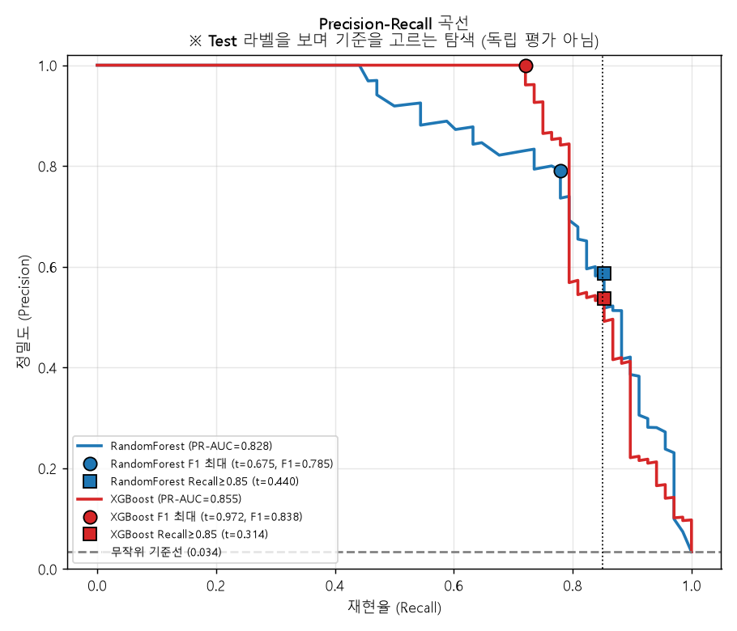
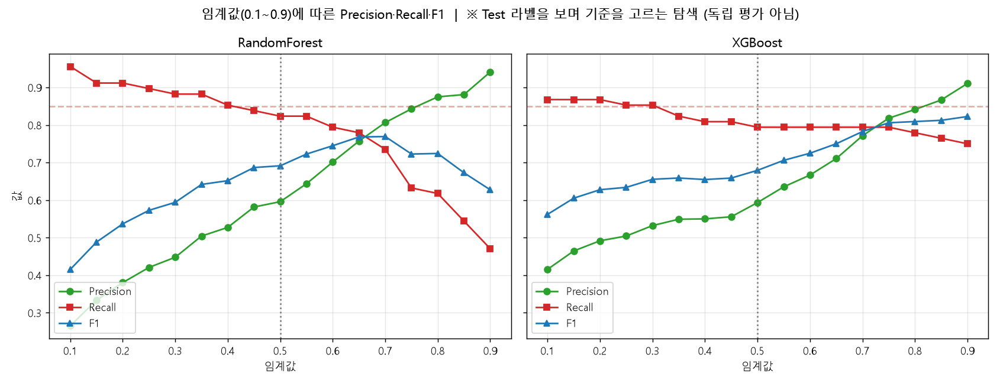
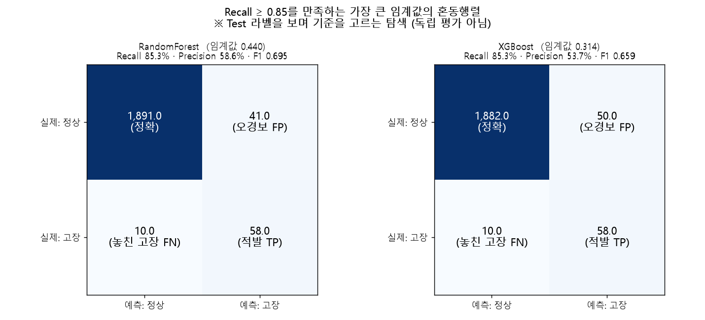
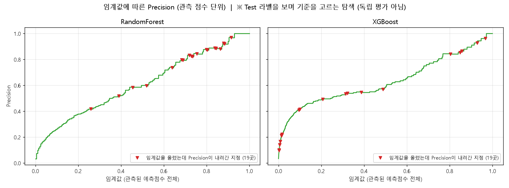

# 임계값에 따른 성능 변화 탐색 (RF vs XGBoost)

**질문:** 저장된 RF·XGBoost Test 예측점수로 임계값에 따른 변화를 탐색해줘. 이번 실습은 Test 라벨을 보며 기준을 고르는 탐색이며 독립 평가가 아니라고 표시하고, (1) Precision-Recall 곡선과 F1 최대 임계값, (2) 임계값 0.1~0.9에 따른 Precision·Recall·F1 꺾은선, (3) 관측된 예측점수 중 Recall ≥ 0.85를 만족하는 가장 큰 임계값, (4) 선택한 기준의 혼동행렬과 Precision·Recall·F1·TP·FN·FP·TN 저장을 해줘. FN은 다운타임 리스크, FP는 점검 비용과 연결해 설명하고, Precision이 임계값을 높인다고 항상 증가하지는 않는다는 점을 실제 곡선으로 확인하고, 현장 성능을 주장하려면 별도 검증 데이터에서 기준을 정해야 한다고 적어줘.

**답변:** Recall ≥ 0.85를 만족하는 가장 큰 임계값은 **랜덤포레스트 0.440, XGBoost 0.314**입니다. 두 모델 모두 재현율 85.3%(고장 68건 중 58건 적발, 10건 놓침)이고, 오경보는 랜덤포레스트 41건, XGBoost 50건입니다.

- 탐색 코드: [threshold_explore.py](threshold_explore.py)
- 입력: Step 2의 3번 폴더의 `test_predictions_both.csv` (원본 Test 2,000건, 고장 68건)

> ⚠️ **이 결과는 Test 라벨을 직접 보면서 기준을 고른 탐색이며, 독립 평가가 아닙니다.** 같은 Test로 임계값을 정하고 성능을 말하면 낙관적인 수치가 나옵니다. **현장 성능을 주장하려면 별도의 검증 데이터에서 기준(임계값)을 정하고, 한 번도 보지 않은 Test로 평가해야 합니다.** 또한 power 등 일부 입력이 합성 데이터 생성 규칙에서 나온 변수라 실제 설비 성능이 아닙니다.

### 1) Precision-Recall 곡선과 F1 최대 임계값

관측된 예측점수 전체를 후보 임계값으로 놓고 F1이 가장 큰 지점을 찾았습니다. ● 표시가 F1 최대, ■ 표시가 Recall ≥ 0.85 지점입니다.

| 모델 | PR-AUC | F1 최대 임계값 | Precision | Recall | F1 | TP | FN | FP |
|---|---|---|---|---|---|---|---|---|
| RandomForest | 0.828 | 0.675 | 79.1% | 77.9% | **0.785** | 53 | 15 | 14 |
| XGBoost | 0.855 | 0.972 | 100% | 72.1% | **0.838** | 49 | 19 | 0 |

- XGBoost의 F1 최대 지점은 임계값 0.97로 극단적입니다. 오경보 0건이지만 고장 19건을 놓칩니다. 68건짜리 Test 하나에서 고른 값이라 과적합일 가능성이 큽니다.
- F1 최대는 재현율 85%를 만족하지 못하므로, 놓친 고장을 줄이는 것이 우선인 목적과는 맞지 않습니다.

### 2) 임계값 0.1~0.9에 따른 Precision·Recall·F1

- 임계값을 올리면 Recall은 내려가고 Precision은 대체로 올라갑니다. 랜덤포레스트는 0.65 부근에서 Precision과 Recall이 만나고 그 부근에서 F1이 최대에 가깝습니다.
- XGBoost는 0.5~0.7 구간에서 Recall이 79%대로 거의 변하지 않습니다. 이 구간에서는 임계값을 올릴수록 Precision이 올라 오경보가 줄어드는 이득이 큽니다.

### 3) Recall ≥ 0.85를 만족하는 가장 큰 임계값 (관측된 예측점수 기준)

| 모델 | 임계값 | Recall | Precision | F1 | TP | FN | FP | TN |
|---|---|---|---|---|---|---|---|---|
| RandomForest | **0.440** | 85.3% | 58.6% | 0.695 | 58 | 10 | 41 | 1,891 |
| XGBoost | **0.314** | 85.3% | 53.7% | 0.659 | 58 | 10 | 50 | 1,882 |
| (참고) RF 기본 0.5 | 0.500 | 82.4% | 59.6% | 0.691 | 56 | 12 | 38 | 1,894 |
| (참고) XGB 기본 0.5 | 0.500 | 79.4% | 59.3% | 0.679 | 54 | 14 | 37 | 1,895 |

- 재현율 85%를 만족하는 점 중 가장 큰 임계값을 골랐으므로 오경보가 가장 적은 지점입니다.
- RF는 기본 0.5에서 0.44로 낮추면 놓친 고장 2건을 더 잡는 대신 오경보가 3건 늘어납니다.
- XGBoost는 0.5에서 0.314로 낮추면 고장 4건을 더 잡는 대신 오경보가 13건 늘어납니다.
- 같은 재현율에서 랜덤포레스트가 오경보를 9건 덜 냅니다.

### 4) 선택한 기준의 혼동행렬 (Recall ≥ 0.85)

저장 파일: `selected_thresholds_metrics.csv` (기본 0.5, F1 최대, Recall≥0.85 세 기준 × 두 모델의 임계값·Precision·Recall·F1·TP·FN·FP·TN)

### FN과 FP의 현장 의미

| 오류 | 의미 | 비용 연결 |
|---|---|---|
| **FN (놓친 고장)** | 실제 고장인데 정상으로 판정 | **다운타임 리스크**: 예고 없는 설비 정지, 생산 중단, 불량·긴급 수리 비용 |
| **FP (오경보)** | 정상인데 고장으로 판정 | **점검 비용**: 불필요한 점검·부품 교체, 정비 인력 투입, 알람 피로(신뢰도 저하) |

- 이 Test(2,000건)에서 임계값을 0.5에서 0.44(RF)로 낮추면 놓친 고장 2건을 줄이는 대신 오경보가 3건 늘어납니다. 고장 1건을 놓쳤을 때의 손실이 오경보 1건의 점검 비용보다 크다고 판단되면 임계값을 낮추는 쪽이 합리적입니다.
- 실제 의사결정에는 FN 1건과 FP 1건의 비용비를 정해야 합니다. 이 데이터에는 비용 정보가 없어서 계산하지 않았습니다.
- 정밀도 59%는 경보 약 10건 중 4건이 오경보라는 뜻입니다. 오경보가 많으면 현장에서 경보를 무시하게 될 위험도 있습니다.

### Precision은 임계값을 높인다고 항상 오르지 않습니다

- 위 꺾은선(0.05 간격)에서는 두 모델 모두 Precision이 계속 올라가는 것처럼 보입니다. 하지만 **관측된 예측점수를 하나씩 따져보면 임계값을 올렸는데 Precision이 내려간 지점이 두 모델 모두 19곳씩 있습니다.**
- 예: RF는 임계값 0.72 → 0.73에서 Precision이 0.831 → 0.825로, XGBoost는 0.469 → 0.488에서 0.573 → 0.568로 내려갑니다.
- 이유: 임계값을 올릴 때 걸러진 샘플이 오경보가 아니라 **진짜 고장**이면 분자(TP)가 줄어서 Precision이 오히려 떨어집니다. 일반적으로는 상승 추세이지만 좁은 구간에서는 흔들립니다.
- 따라서 "임계값을 높이면 정밀도가 오른다"고 가정하지 말고, 이처럼 실제 곡선으로 확인해야 합니다.

### 저장 파일

| 파일 | 내용 |
|---|---|
| `selected_thresholds_metrics.csv` | 기준별(기본/F1 최대/Recall≥0.85)·모델별 임계값, Precision, Recall, F1, TP, FN, FP, TN |
| `threshold_results.json` | 위 결과 전체와 0.05 간격 격자 결과, Precision 감소 구간 |
| `pr_curve.png`, `threshold_lines.png`, `precision_nonmonotonic.png`, `confusion_recall085.png` | 그래프 |
