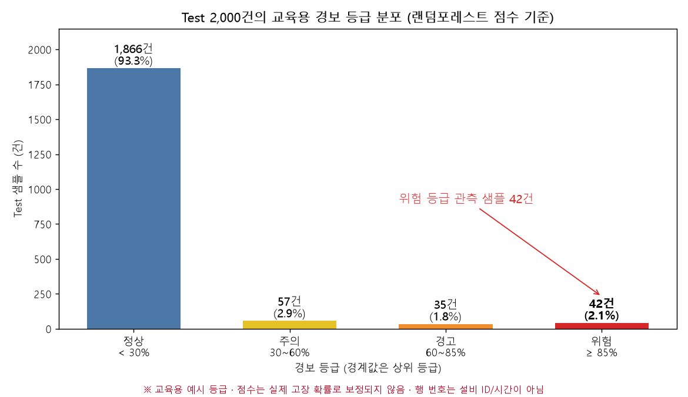
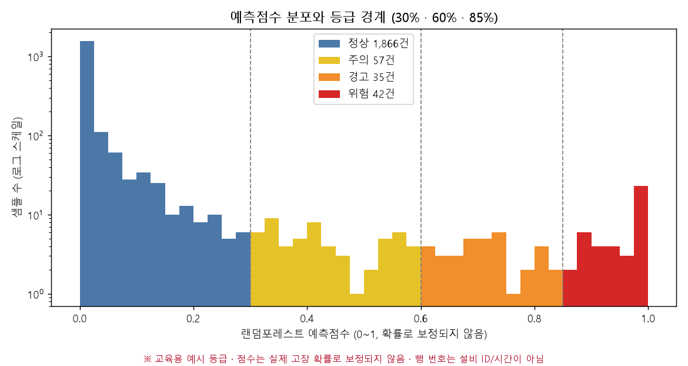

# 교육용 경보 기준 설계 (RF 예측점수)

**질문:** RF 예측점수를 이용한 교육용 경보 기준을 설계해줘. 등급은 정상 <30%, 주의 30~60%, 경고 60~85%, 위험 ≥85%이고 경계값은 상위 등급에 넣어줘. 이 점수는 실제 고장 확률로 보정되지 않았다고 적고, 각 등급의 (1) 확인 내용과 점검 조치, (2) SLA, (3) 에스컬레이션 경로(담당자 → 팀장 → 공장장)를 제안해줘. 위험 등급은 담당자 즉시 확인·긴급 점검을 제안하되 정지 여부는 현장 절차에 따라 판단하게 해줘. Test의 등급별 분포와 위험 등급 관측 샘플 건수를 시각화하고, 행 번호를 설비 ID나 시간으로 해석하지 말고, 등급·조치·SLA는 교육용 예시이며 실제 운영 전에 현장 기준으로 검증해야 한다고 표시해줘.

**답변:** 4단계 경보 등급과 등급별 조치·SLA·에스컬레이션 예시를 설계했습니다. Test 2,000건에서 **위험 등급은 42건(2.1%)** 입니다.

> ⚠️ **이 등급 기준은 교육용 예시입니다. 등급 경계, 조치, SLA, 에스컬레이션은 실제 운영 전에 현장 기준(설비 특성, 안전 규정, 인력, 비용)으로 검증해야 합니다.**
> ⚠️ **랜덤포레스트 점수(0~1)는 실제 고장 발생 확률로 보정되지 않았습니다.** 모델은 정상:고장이 1:1이 되도록 SMOTENC로 보강한 데이터로 학습해서, 점수가 실제 고장률(3.4%)보다 높게 나오는 경향이 있습니다. "85% 이상 = 고장 확률 85%"라고 읽으면 안 됩니다. 아래 %는 점수 구간의 이름일 뿐입니다.
> ⚠️ 샘플 번호(UDI)와 행 번호는 **설비 ID나 시간이 아닙니다.** AI4I는 개별 관측 샘플로 구성된 합성 데이터입니다.

- 분류 코드: [alert_grades.py](alert_grades.py)
- 입력: Step 2의 3번 폴더의 `test_predictions_both.csv` (랜덤포레스트 예측점수, 원본 Test 2,000건)

### 1) 등급 정의 (경계값은 상위 등급)

| 등급 | 점수 범위 | 규칙 |
|---|---|---|
| 정상 | 점수 < 0.30 | |
| 주의 | 0.30 ≤ 점수 < 0.60 | 0.30은 주의 |
| 경고 | 0.60 ≤ 점수 < 0.85 | 0.60은 경고 |
| 위험 | 점수 ≥ 0.85 | 0.85는 위험 |

경계값 처리를 확인했습니다. 점수가 정확히 0.30인 샘플 1건은 주의로, 정확히 0.60인 샘플 2건은 경고로 분류했습니다(정확히 0.85인 샘플은 없음). 부동소수점 오차 때문에 경계값이 하위 등급으로 밀리지 않도록 소수 9자리로 반올림해서 비교했습니다.

### 2) 등급별 조치·SLA·에스컬레이션 (교육용 예시)

| 등급 | 담당자가 확인할 내용 | 점검 조치 |
|---|---|---|
| **정상** | 경보 없음. 정기 점검 일정과 센서 기록만 유지 | 정기 점검 계획에 따름 |
| **주의** | 예측점수, 센서값(토크·회전 속도·공구 마모·온도) 이상 여부, 최근 점검 이력 | 다음 정기 점검 앞당김 검토. 공구 마모·냉각 상태 육안 확인 예약 |
| **경고** | 예측점수, 센서값, 최근 경보 이력, 현장 이상 징후(진동·소음·온도) | 해당 설비 점검 실시(공구 마모·부하·냉각·전력 상태), 점검 결과 기록 |
| **위험** | **담당자가 즉시 확인**: 예측점수, 센서값, 현재 작업 상태, 이상 징후 | **긴급 점검 실시.** 정지 여부는 **현장 안전·품질·생산 절차와 책임자 판단에 따름**(자동 정지가 아님) |

| 등급 | 확인 SLA | 조치 SLA | 에스컬레이션 |
|---|---|---|---|
| 정상 | 해당 없음 | 해당 없음 | 해당 없음 |
| 주의 | 4시간 이내 확인 착수 | 24시간 이내 점검 일정 수립 | 담당자 → (8시간 내 미확인 시) 팀장. 공장장은 주간 요약만 |
| 경고 | 1시간 이내 확인 | 4시간 이내 점검 착수 | 담당자 → (1시간 내 미확인 시) 팀장 → (8시간 내 미해소 시) 공장장 보고 |
| 위험 | 즉시 확인 (15분 이내 응답) | 30분 이내 긴급 점검 착수 | 담당자 → (15분 내 미응답 시) 팀장 → (30분 내 미응답 또는 이상 지속 시) 공장장 |

공통 운영 원칙(예시):
- 점검 결과가 "이상 없음"이면 사유를 기록해 오경보 이력으로 남기고, 임계값 재검증에 활용합니다.
- 모델 설명(SHAP 등)은 점검할 곳을 정하는 참고 자료일 뿐 고장 원인을 단정하는 근거가 아닙니다.
- 설비 정지 같은 운전 결정은 모델이 아니라 현장 절차와 책임자가 합니다.
- 전체 표는 [alert_policy.csv](alert_policy.csv)에 저장했습니다.

### 3) Test 등급별 분포

| 등급 | 샘플 수 | 비율 | (참고) Test 라벨의 실제 고장 건수 |
|---|---|---|---|
| 정상 | 1,866 | 93.30% | 8 |
| 주의 | 57 | 2.85% | 6 |
| 경고 | 35 | 1.75% | 17 |
| **위험** | **42** | **2.10%** | 37 |
| 합계 | 2,000 | 100% | 68 |

**위험 등급 관측 샘플은 42건**입니다. 경고 이상은 77건(3.85%), 주의 이상 알림은 134건(6.7%)입니다. 담당자가 실제로 대응해야 하는 알림 규모를 가늠할 때 이 숫자를 참고할 수 있습니다.

점수가 0 근처에 몰려 있고, 0.3~0.85 사이에는 샘플이 적게 흩어져 있으며, 0.95 이상에 다시 몰립니다. 모델이 확신하는 샘플이 양 끝에 많고 중간 점수 구간은 비교적 적습니다.

> "(참고) 실제 고장 건수" 열은 **Test 라벨을 사용해 센 값**이며, 등급 경계를 만든 근거가 아닙니다. 등급별 실제 고장 비율(위험 37/42 = 88%, 경고 17/35 = 49%, 주의 6/57 = 11%, 정상 8/1,866 = 0.4%)은 **이 Test 한 번에서 관측된 값**일 뿐이며, 샘플 수가 적고(경고 35건, 위험 42건) 점수가 보정되지 않았으므로 등급을 확률로 해석하는 근거가 되지 않습니다.

### 4) 어느 등급부터 알림으로 볼 것인가 (참고, Test 기준)

| 알림 기준 | 알림 건수 | 적발한 고장 | 놓친 고장 | 오경보 | 재현율 |
|---|---|---|---|---|---|
| 주의 이상 | 134 | 60 | 8 | 74 | 88.2% |
| 경고 이상 | 77 | 54 | 14 | 23 | 79.4% |
| 위험만 | 42 | 37 | 31 | 5 | 54.4% |

- **위험 등급만 대응하면 고장의 절반 가까이(31건, 45.6%)를 놓칩니다.** 위험 등급은 오경보가 적지만(5건) 놓치는 고장이 많습니다. 주의·경고 단계에서도 점검이 실제로 이루어져야 재현율이 유지됩니다.
- 앞에서 Recall ≥ 0.85를 기준으로 고른 임계값 0.44(Step 2의 4번 폴더)는 이 등급표에서 **주의 등급 안**에 있습니다. 즉 재현율 85% 이상을 목표로 하면 주의 등급 이상(점수 0.30 이상)까지 알림으로 다뤄야 하며, 오경보는 늘어납니다.
- 이 표도 Test 라벨을 보고 센 값이라 독립 평가가 아닙니다.

### 저장 파일

| 파일 | 내용 |
|---|---|
| `alert_policy.csv` | 등급별 점수 범위, 확인 내용, 점검 조치, SLA, 에스컬레이션 (교육용 예시) |
| `grade_distribution.csv`, `grade_summary.json` | 등급별 샘플 수·비율, 누적 기준 결과 |
| `test_alert_grades.csv` | Test 2,000건의 샘플 번호(UDI)·점수·등급 (샘플 번호는 설비 ID가 아님) |
| `grade_distribution.png`, `score_histogram_grades.png` | 등급 분포 그림 |
