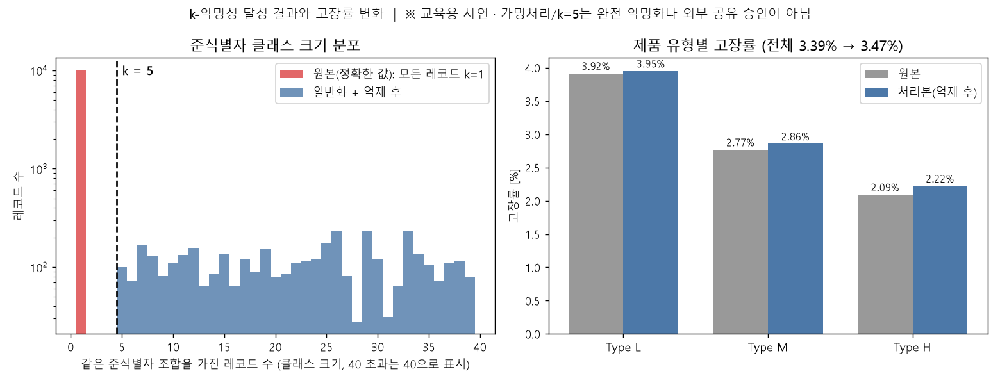
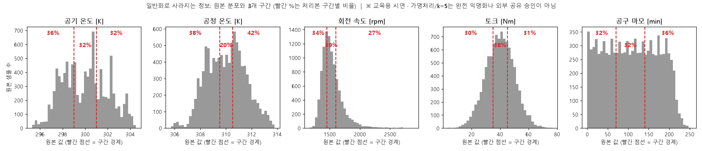

# 가명처리와 k-익명성 검토 시연 (공개 합성 데이터)

**질문:** 공개 합성 데이터로 가명처리와 k-익명성 검토를 시연해줘. (1) UDI는 무작위 대체 ID, Product ID는 대체 시리얼로 바꾸고, (2) Type과 센서 5개를 준식별자로 구간 일반화해 최소 k=5를 검증하고, (3) 원본·처리본의 통계와 고장률을 비교해 분석 정보가 달라진 부분을 보여주고, (4) 대응표는 별도 비공개 폴더에 저장하고 공유용 처리본에는 넣지 마. 가명처리와 k=5가 완전 익명화나 외부 공유 승인을 뜻하지 않는다고 적고, 다른 자료와의 결합·민감 속성(고장 여부) 노출 가능성을 정리하고, 외부 AI 사용 전 확인할 항목, 실제 자료는 승인된 환경에서 먼저 처리해야 한다는 설명, 사내 실행 대안(Llama·Mistral 등), 처리본·대응표 보관 원칙도 정리해줘.

**답변:** 공유용 처리본(9,701건)은 준식별자 기준 **최소 k=5**를 만족합니다. 대응표는 프로젝트 루트의 별도 비공개 폴더에만 저장했고 처리본에는 넣지 않았습니다. 다만 **일반화 때문에 분석 정보가 크게 줄었습니다**(단순 모델 ROC-AUC 0.968 → 0.779).

> ⚠️ **가명처리와 k=5는 완전 익명화가 아니며, 외부 공유 승인을 뜻하지 않습니다.** 이 문서는 **공개 합성 데이터로 한 교육용 시연**입니다. 이 처리본을 외부에 공유해도 된다는 근거가 아닙니다. 실제 회사 자료의 공유 가능 여부는 회사의 보안·개인정보·법무 담당과 승인 절차로 결정해야 합니다.
> ⚠️ 특히 **이 데이터는 원본이 공개돼 있어서** 처리본을 원본과 직접 대조할 수 있습니다. 실제 업무에서는 생산 일지, 설비 가동 로그, 정비 이력 같은 다른 자료와의 결합이 같은 역할을 합니다(아래 "노출 가능성" 참고).

- 처리 코드: [pseudonymize_k5.py](pseudonymize_k5.py)
- 공유용 처리본(공유 *후보*, 승인 아님): [processed_k5.csv](processed_k5.csv)
- 비공개 대응표 위치: 프로젝트 루트의 `_비공개_대응표/` (Step 폴더 밖, `.gitignore`로 저장소에서 제외)

## 1. 가명처리 내용

| 항목 | 처리 |
|---|---|
| UDI | 무작위 대체 ID(`S-` + 영숫자 8자)로 교체. 암호학적 난수(`secrets`)로 생성해 같은 코드를 다시 실행해도 같은 값이 나오지 않음 |
| Product ID | 대체 시리얼(`SN-` + 영숫자 10자)로 교체. 원래 ID의 제품 등급 글자(L/M/H) 같은 정보를 담지 않음 |
| 행 순서 | **무작위로 섞음.** 원본 순서를 유지하면 ID를 바꿔도 행 위치로 원본을 추적할 수 있음 |
| 파생변수(temp_diff, power 등) | **공유본에서 제외.** power = 토크 × 회전 속도라서 포함하면 구간 일반화한 값을 되돌릴 수 있음 |
| 대응표 | `_비공개_대응표/id_mapping_PRIVATE.csv`에만 저장(대체 ID ↔ 원본 UDI, 대체 시리얼 ↔ Product ID, 억제 여부) |

공유용 처리본에는 원본 UDI·Product ID 값도, 대응표 열도 없음을 검사했습니다(열 이름과 값 모두 확인, 대체 ID가 원본 번호와 겹치지 않음).

## 2. 준식별자 일반화와 k-익명성 검증

준식별자는 **Type + 센서 5개**입니다. 정확한 센서값은 조합이 거의 유일해서 다른 자료와 결합하면 개별 샘플을 찾아낼 수 있기 때문입니다.

| 구간 설계 (선택안 A) | 낮음 | 중간 | 높음 |
|---|---|---|---|
| 공기 온도 [K] | 299 미만 | 299 이상 ~ 301 미만 | 301 이상 |
| 공정 온도 [K] | 309.5 미만 | 309.5 이상 ~ 310.5 미만 | 310.5 이상 |
| 회전 속도 [rpm] | 1,450 미만 | 1,450 이상 ~ 1,600 미만 | 1,600 이상 |
| 토크 [Nm] | 35 미만 | 35 이상 ~ 45 미만 | 45 이상 |
| 공구 마모 [min] | 70 미만 | 70 이상 ~ 140 미만 | 140 이상 |

양 끝 구간은 열린 구간으로 만들어 극단값이 따로 눈에 띄지 않게 했습니다.

| 단계 | 결과 |
|---|---|
| 원본(정확한 값) | 클래스 10,000개, **최소 k=1, 레코드의 100%가 유일** |
| 일반화 후(억제 전) | 클래스 436개, 최소 k=1 (k<5 클래스 존재) |
| 억제 대상 | 299건(2.99%) — k<5 클래스에 속한 레코드를 공유본에서 삭제. 이 중 고장 2건 |
| **억제 후(공유본)** | **클래스 310개, 최소 k=5**, 레코드 9,701건 |

## 3. 원본 vs 처리본: 달라진 분석 정보

(같은 9,701건 기준. 처리본의 센서값은 구간 대표값으로 계산했고, 열린 구간은 인접 구간 폭의 절반을 사용)

**센서 통계**

| 변수 | 평균(원본→처리본) | 표준편차(원본→처리본) | 서로 다른 값의 수 |
|---|---|---|---|
| 공기 온도 | 300.00 → 299.93 | 2.01 → 1.65 | 93 → 3 |
| 공정 온도 | 310.00 → 310.04 | 1.50 → 0.89 | 82 → 3 |
| 회전 속도 | 1,538.65 → 1,514.55 | 181.18 → 116.72 | 941 → 3 |
| 토크 | 40.00 → 40.09 | 10.04 → 7.86 | 577 → 3 |
| 공구 마모 | 108.25 → 107.31 | 63.62 → 57.73 | 246 → 3 |

평균은 비슷하게 유지되지만 **변동(표준편차)이 줄어듭니다.** 특히 회전 속도는 181 → 117로 35% 감소했습니다.

**고장률**

| 구분 | 원본 | 처리본 | 비고 |
|---|---|---|---|
| 전체 | 3.39% | 3.47% | 억제한 299건 중 고장은 2건(0.67%)뿐이라 변화는 작음 |
| Type L | 3.92% (6,000건) | 3.95% (5,944건) | |
| Type M | 2.77% (2,997건) | 2.86% (2,903건) | |
| Type H | 2.09% (1,003건) | 2.22% (854건) | **H는 14.9%가 삭제됨** (소수 유형일수록 k<5 클래스가 많음) |

**상관·예측 성능**

| 지표 | 원본 | 처리본 |
|---|---|---|
| 회전 속도와 고장의 상관 | −0.044 | −0.140 (**크기가 3배 이상으로 커짐, 왜곡**) |
| 토크와 고장의 상관 | 0.192 | 0.151 |
| 공구 마모와 고장의 상관 | 0.105 | 0.075 |
| 토크–회전 속도 상관 | −0.877 | −0.839 |
| **단순 랜덤포레스트 ROC-AUC** | **0.968** | **0.779** |
| 단순 랜덤포레스트 PR-AUC | 0.820 | **0.119** |

단순 랜덤포레스트 비교는 같은 레코드, 같은 분할(80/20, random_state=42)에서 센서 5개만 쓴 기준선입니다(Step 2의 모델과 다릅니다). **센서값을 3개 구간으로 뭉치면 고장을 가려내는 정보가 크게 사라집니다.** 고장 조건이 값의 세밀한 경계와 변수 조합에 달려 있기 때문입니다.

**그 밖에 사라진 정보:** 센서의 정확한 값, 파생변수(power 등), 원본 행 순서, 원본 ID와의 연결(대응표 없이는 복원 불가), 삭제된 299건(극단값이 많은 샘플).

**개인정보–유용성 trade-off (설계 비교)**

| 설계 | 구간 수 | 클래스 수 | 억제 레코드 | 억제율 | 억제된 고장 |
|---|---|---|---|---|---|
| E 더 거친 일반화 | 13 | 189 | 103 | 1.03% | 5 |
| **A (선택) 센서별 3구간** | 15 | 310 | 299 | 2.99% | 2 |
| F 더 세밀한 일반화 | 19 | 505 | 855 | 8.55% | 38 |

구간을 세밀하게 하면 정보는 더 남지만 k<5가 되는 레코드가 늘어 삭제가 급증합니다(F는 8.55%, 삭제된 고장 38건으로 고장률이 왜곡됨).

## 4. 노출 가능성 (k=5로도 남는 위험)

| 위험 | 설명 |
|---|---|
| **다른 자료와의 결합(연결 공격)** | k=5는 "준식별자 조합이 같은 레코드가 최소 5건"이라는 뜻일 뿐입니다. 준식별자 외의 정보(생산 일지, 설비 가동 로그, 정비 이력, 작업자 근무표, 공개 원본 데이터)와 결합하면 후보가 줄어듭니다. **이 시연에서는 원본 데이터가 공개돼 있어서 처리본의 각 행을 구간에 해당하는 원본 후보 5건 이상으로 바로 연결**할 수 있습니다. |
| **민감 속성(고장 여부) 노출** | 같은 클래스의 레코드가 모두 같은 값이면 그 클래스에 속한다는 것만 알아도 속성이 드러납니다. 공유본에서 **219개 클래스(5,049건, 52.0%)가 전부 정상**입니다. 이 구간에 속한 샘플은 "고장이 없다"고 확정됩니다. 반대로 전부 고장인 클래스는 없습니다. k-익명성은 이런 속성 노출을 막지 못해서 l-다양성 같은 추가 검토가 필요합니다. |
| **배경지식·소수 집단** | Type H처럼 건수가 적은 집단은 클래스가 작아지기 쉽고, 억제 후에도 특이한 조합이 눈에 띌 수 있습니다. |
| **준식별자 선택의 한계** | 이 시연은 Type과 센서 5개만 준식별자로 봤습니다. 실제로는 날짜·시간, 라인·설비 번호, 작업자, 위치 같은 열이 더 강한 식별자가 됩니다. 이 데이터에는 그런 열이 없지만 실제 자료에는 흔합니다. |
| **고장 라벨 자체의 민감성** | 고장 이력은 설비 신뢰성, 품질, 영업비밀과 연결될 수 있어 회사에 따라 민감정보입니다. |
| **ID 대체의 한계** | 대체 ID는 값 자체가 의미를 담지 않지만, 같은 ID를 여러 파일에 반복해 쓰면 그 파일들끼리 연결(링크)됩니다. 대응표가 유출되면 가명처리는 의미가 없어집니다. |

## 5. 외부 AI 사용 전 확인할 항목

회사 자료를 외부 AI 서비스에 올리기 전에 아래를 먼저 확인해야 합니다. **가명처리를 했다는 이유만으로 외부 AI에 올려도 되는 것은 아닙니다.**

| 확인 항목 | 질문 예시 |
|---|---|
| **회사의 사용 기준** | 외부 AI 사용 정책과 승인된 도구 목록이 있는가? 이 자료의 등급(대외비 등)에서 허용되는가? 누구의 승인이 필요한가? |
| **학습 사용·보관 조건** | 입력한 내용이 모델 학습에 쓰이는가? 쓰지 않도록 설정(옵트아웃)하거나 계약으로 보장되는가? 보관 기간, 삭제 방법, 데이터 처리 위치(국가), 사람이 열람하는 경우가 있는가? |
| **민감정보** | 개인정보, 영업비밀, 설비 설계·공정 파라미터, 고객·협력사 정보, 보안 정보가 들어 있는가? 열 이름·파일 이름·코드·주석에도 식별 정보가 없는가? |
| **접근 권한** | 서비스 계정을 누가 어떻게 관리하는가? 대화·파일의 공유 링크, 팀 공유 범위, 연동 앱·플러그인의 접근 범위, 접근 기록(로그)이 있는가? |

**실제 회사 자료는 승인된 환경에서 먼저 처리해야 합니다.** 가명처리·일반화·k-익명성 검토는 회사가 승인한 환경(사내망, 승인된 분석 서버)에서 먼저 하고, 처리본을 외부에 보낼 수 있는지는 담당 부서의 승인 후에 결정합니다. 이 시연이 공개 합성 데이터를 쓴 이유도 그 때문입니다. 시연에 쓴 코드와 절차를 실제 자료에 적용할 때도 같은 원칙이 적용됩니다.

## 6. 사내 실행 대안

외부 서비스에 자료를 보내기 어려우면 모델을 사내 환경에서 실행하는 방법을 검토할 수 있습니다.

| 대안 | 설명 | 고려할 점 |
|---|---|---|
| 오픈 가중치 모델 사내 실행 (Llama 계열, Mistral 계열 등) | 사내 서버나 회사 전용 클라우드(VPC)에서 실행해 자료가 사내 경계 밖으로 나가지 않게 함 | 라이선스와 사용 정책(상업 이용 조건 등) 확인, GPU·운영 인력·비용, 보안 패치와 취약점 관리, 접근 통제와 로깅, 모델 품질 평가(업무에 맞는지) |
| 회사가 계약·승인한 엔터프라이즈 AI 환경 | 학습 미사용, 보관 기간, 데이터 위치, 접근 통제를 계약과 설정으로 보장받는 서비스 | 계약 조건 확인, 보안·법무 승인, 사용자 교육 |
| 전통적 분석 도구만 사용 | 이 실습처럼 로컬 Python·scikit-learn 등으로 분석 | AI 서비스가 필요 없는 작업이면 가장 단순함 |

특정 제품이나 모델이 안전하다고 보장하는 것은 아닙니다. 어떤 방식이든 도입 전에 회사의 보안·법무 절차와 모델·서비스 조건 확인이 필요합니다.

## 7. 처리본·대응표 보관 원칙

| 대상 | 원칙 |
|---|---|
| **대응표** | 처리본과 **분리해서 보관**하고, 같은 폴더·같은 메신저·같은 AI 도구에 올리지 않음. 접근 인원은 꼭 필요한 최소로 제한하고 접근 기록을 남김. 암호화하고, 백업도 처리본과 따로 보관. 저장소(git)에서 제외. 필요 없어지면 보존 기간에 따라 파기 |
| **공유용 처리본** | 승인 없이 외부로 보내지 않음. 목적, 수령자, 기간, 보관 방법을 기록하고, 재식별 시도 금지·제3자 제공 금지 같은 조건을 합의. 버전을 관리하고 공유한 이력을 남김 |
| **원본** | 가장 높은 수준으로 보호. 처리 작업은 승인된 환경에서만 수행 |
| **중간 산출물** | 처리 과정의 임시 파일, 로그, 노트북 출력에 원본 값이 남지 않았는지 확인하고 정리 |
| **재검토** | 새 자료와 결합될 가능성, 새 열의 추가, 공유 범위 변경이 생기면 준식별자와 k를 다시 검토 |

이번 시연의 대응표 위치: 프로젝트 루트 `_비공개_대응표/` — Step 폴더 안에 두지 않았고 `.gitignore`에 등록했습니다. 다만 **이 폴더의 파일 권한은 운영체제가 자동으로 막아 주지 않습니다.** 실제 운영에서는 접근 권한과 암호화를 따로 설정해야 합니다.

## 저장 파일

| 위치 | 파일 | 내용 |
|---|---|---|
| 이 폴더 | `processed_k5.csv` | 공유 후보 처리본 (대체 ID·시리얼, 구간 일반화한 준식별자, 고장 라벨) — **공유 승인 아님** |
| 이 폴더 | `k_anonymity_report.json` | k, 구간 경계, 클래스 수, 억제, l-다양성, 통계·고장률 비교, AUC, 설계 비교 |
| 이 폴더 | `k_anonymity_overview.png`, `generalization_bins.png`, `pseudonymize_k5.py` | 그림과 코드 |
| `D:\PdM_Lab\_비공개_대응표\` | `id_mapping_PRIVATE.csv`, `README_비공개.txt` | **비공개** 대응표와 취급 안내 (공유 금지) |
