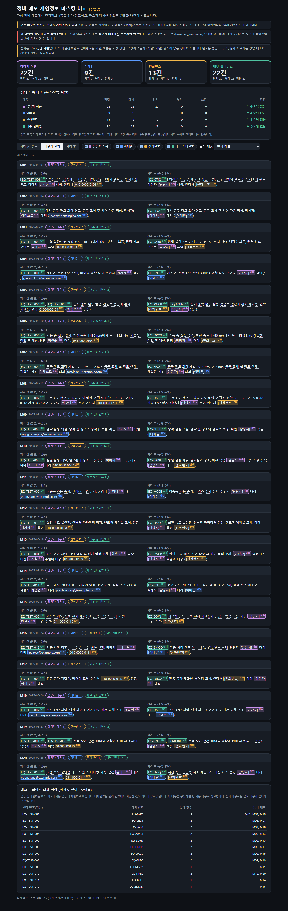

# 정비 메모 민감정보 마스킹 시연 (수업용 가상 정보)

**질문:** 정비 메모에 들어간 민감정보를 찾아 가리고 처리 전후를 비교하는 HTML 화면을 만들어줘. 실제 개인정보 대신 가상 담당자명·이메일·전화번호·내부 설비번호가 들어간 정비 메모 20건을 만들어 쓰고(이메일은 example.com, 내부 번호는 EQ-TEST 형식, 모두 수업용 가상정보로 표시), (1) 네 종류 민감정보를 원문에서 색상으로 강조, (2) 담당자·연락처는 마스킹하고 설비번호는 일관된 대체번호로 교체, (3) 고장 증상·정비 내용은 유지하며 원문과 처리 결과를 나란히 표시, (4) 항목별 탐지·처리 건수와 처리 전후 보기 기능을 넣어줘. 가상정보의 정답 목록을 저장해 누락 여부를 확인하고, 처리한 CSV와 `privacy_viewer.html`을 저장하고, 원문 비교는 수업용이며 외부 공유본에는 원문과 대응표를 포함하면 안 된다고 표시해줘. 서버 없이 브라우저에서 동작해야 해.

**답변:** 가상 메모 20건에서 민감정보 **66건(이름 22 · 이메일 9 · 전화 13 · 설비번호 22)** 을 모두 찾아 처리했습니다. 정답 목록과 비교해 **누락 0건, 오탐 0건**이고, 고장 증상·정비 내용 문구 52개는 전부 그대로 남았습니다.

> ⚠️ **모든 메모와 정보는 수업용 가상 정보입니다.** 이름은 가상, 이메일은 `example.com`, 전화번호는 `0000` 형태, 내부 설비번호는 `EQ-TEST-###` 형식입니다. 실제 개인정보가 아닙니다.
> ⚠️ **화면의 원문 비교는 수업용입니다. 실제 외부 공유본에는 원문과 대응표를 포함하면 안 됩니다.** 공유 후보는 처리 결과(`masked_memos.csv`)뿐이며, `privacy_viewer.html` 자체에는 원문이 들어 있어 외부에 공유하면 안 됩니다.

- 화면: [privacy_viewer.html](privacy_viewer.html) (서버 없이 열림)
- 처리 결과 CSV(공유 후보): [masked_memos.csv](masked_memos.csv)
- 코드: [make_memos_and_mask.py](make_memos_and_mask.py)(메모 생성·탐지·마스킹·검증), [build_viewer.py](build_viewer.py) + [viewer_template.html](viewer_template.html)

## 처리 규칙

| 항목 | 탐지 방법 | 처리 |
|---|---|---|
| 담당자 이름 (가상) | 가상 담당자 명단 8명 + "성씨 + 2글자 + 직함(책임·대리·주임·팀장)" 패턴(명단에 없는 이름용) | `[담당자]`로 마스킹 (직함은 유지) |
| 이메일 (example.com) | 이메일 패턴 | `[이메일]`로 마스킹 |
| 전화번호 (가상) | `010-0000-0101`, `010 0000 0103`, `01000000104`, `031-000-0105` 같은 하이픈·공백·무구분 형식. `1,450 rpm` 같은 천 단위 숫자는 제외 | `[전화번호]`로 마스킹 |
| 내부 설비번호 | `EQ-TEST-###` 패턴 | **일관된 무작위 대체번호**(`EQ-` + 영숫자 4자). 같은 번호는 모든 메모에서 같은 대체번호. 원래 번호에서 계산한 값이 아니라 무작위이므로 번호 규칙으로 되돌릴 수 없음 |
| 고장 증상·정비 내용 | 건드리지 않음 | 그대로 유지 (화면에서 점선 밑줄로 표시) |

## 결과

**항목별 탐지·처리 건수와 정답 대조**

| 항목 | 정답 | 탐지 | 일치 | 누락 | 오탐 |
|---|---|---|---|---|---|
| 담당자 이름 | 22 | 22 | 22 | 0 | 0 |
| 이메일 | 9 | 9 | 9 | 0 | 0 |
| 전화번호 | 13 | 13 | 13 | 0 | 0 |
| 내부 설비번호 | 22 (12종) | 22 | 22 | 0 | 0 |
| **합계** | **66** | **66** | **66** | **0** | **0** |

- **정답 목록은 탐지 코드와 독립적입니다.** 메모를 작성할 때 민감정보에 표시를 달아 그 표시에서 정답을 뽑았고, 위치(시작·끝)까지 일치해야 "일치"로 셌습니다. 정답은 `classroom_only/ground_truth.csv`에 저장했습니다.
- **오탐을 확인하기 위한 함정 문구**를 메모에 넣었습니다: `회전 속도 1,450 rpm`, `토크 58.8 Nm`, `공구 마모 202 min`, `공정 온도 310.5 K`, `로트 LOT-2025-0312`, 날짜. 모두 처리되지 않고 그대로 남았습니다.
- **처리 전후 비교:** 원문에는 민감정보가 색상으로 강조되고, 처리 결과에는 대체된 토큰이 같은 색으로 강조됩니다. 색에만 의존하지 않도록 이름·메일·전화·설비 라벨을 함께 붙였습니다.

**화면 기능:** 처리 전 / 나란히 / 처리 후 보기 전환, 항목별 강조 켜기·끄기, "해당 정보가 있는 메모만" 필터, 항목별 탐지·처리 건수 카드, 정답 대조표, 설비번호 대체 현황 표(수업용).

## 검증

| 점검 | 결과 |
|---|---|
| 처리 결과에 원문 민감값이 남았는가 | 없음 (66개 값 모두 확인) |
| `EQ-TEST`, `example.com`, 전화번호 형태 문자열 잔존 | 없음 |
| 설비번호 12종이 대체번호와 일대일, 모든 메모에서 일관 | 확인 |
| 증상·정비 문구 유지 | 52개 중 52개 유지 |
| 화면의 처리 결과 텍스트 == 저장된 CSV | 20건 모두 일치 |
| 카드 건수 == CSV 합계 == 정답 건수 | 이름 22, 이메일 9, 전화 13, 설비 22 일치 |
| 모드 전환·필터·강조 끄기 | 처리 전/후 보기 열 개수, 이메일 메모 9건 필터, 이름 강조 끄기 모두 동작 |
| 화면 너비 820 / 390px | 가로 스크롤 없음 |
| 브라우저 오류 | 없음 |

**첫 실행에서 정답 대조가 잡아낸 문제 2건 (수정 완료):**
1. 전화번호 규칙이 `010-0000-0112,`처럼 뒤에 쉼표가 붙으면 놓쳤습니다(천 단위 숫자를 피하려고 쉼표 뒤를 모두 막았기 때문). **누락 1건**으로 드러났고, 숫자 사이의 쉼표만 제외하도록 고쳤습니다.
2. 탐지기가 `최샘플`을 이름으로 잡았는데 정답 목록에는 빠져 있었습니다(메모를 쓸 때 표시를 빠뜨린 입력 실수). **오탐처럼 보였지만 정답 목록 쪽 오류**였고 정답을 고쳤습니다.

정답 대조는 규칙의 결함뿐 아니라 정답 목록의 실수도 찾아낸다는 점에서 둘 다 사람이 확인해야 합니다.

## 한계와 주의

- **규칙·명단 기반 탐지의 한계:** 이름은 가상 명단과 "성씨+2글자+직함" 패턴으로 찾습니다. 직함 없이 쓴 명단 밖 이름, 별명, 영문 이름, 다른 형식의 전화번호(예: `+82`, 내선번호)나 이메일은 놓칠 수 있습니다. 실제 자료에서는 규칙을 현장 형식에 맞추고, 정답 대조와 사람의 검토를 반드시 거쳐야 합니다.
- **마스킹해도 남는 정보:** 날짜, 직함, 설비의 대체번호가 메모 간에 연결되는 점(같은 대체번호 = 같은 설비), 증상·정비 내용 자체가 다른 자료와 결합되면 식별에 도움이 될 수 있습니다. 대체번호의 일관성은 분석에는 유용하지만 연결 가능성을 만듭니다.
- **대응표는 비공개:** 설비번호 대응표는 `D:\PdM_Lab\_비공개_대응표\equipment_mapping_PRIVATE.csv`에만 저장했고(`.gitignore`로 저장소 제외), 처리 결과 CSV에는 넣지 않았습니다. 이 폴더의 파일 권한은 운영체제가 자동으로 막아 주지 않으므로 실제 운영에서는 접근 권한과 암호화를 따로 설정해야 합니다.
- **`privacy_viewer.html`과 `classroom_only/` 폴더는 원문을 포함합니다.** 가상 정보여서 시연에는 문제가 없지만, 실제 자료로 같은 화면을 만들었다면 외부에 공유하면 안 됩니다.
- 실제 회사 메모에 적용할 때는 승인된 환경에서 먼저 처리하고, 외부 AI 서비스에 올리기 전 회사 기준을 확인하세요(Step 3의 4번 폴더 문서 참고).

## 저장 파일

| 위치 | 파일 | 내용 |
|---|---|---|
| 이 폴더 | `masked_memos.csv` | **처리 결과(공유 후보)**: 메모 ID, 날짜, 마스킹된 본문, 항목별 탐지 건수 |
| 이 폴더 | `privacy_viewer.html` | 처리 전후 비교 화면 (원문 포함, 수업용·공유 금지) |
| `classroom_only/` | `memos_original_FICTIONAL.csv`, `ground_truth.csv`, `viewer_data.json` | 가상 원문 20건, 정답 목록 66건, 화면용 데이터 (수업용) |
| `D:\PdM_Lab\_비공개_대응표\` | `equipment_mapping_PRIVATE.csv` | 설비번호 ↔ 대체번호 대응표 (**비공개**) |
